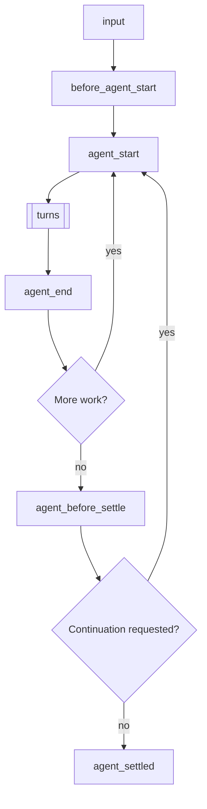
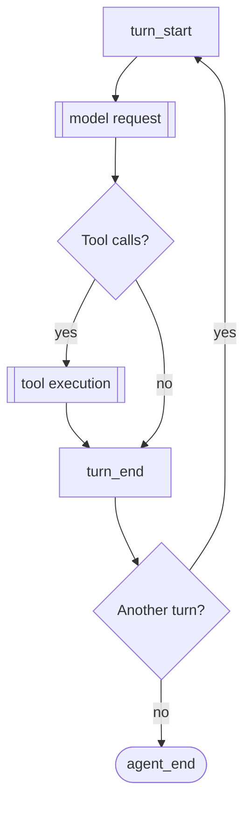
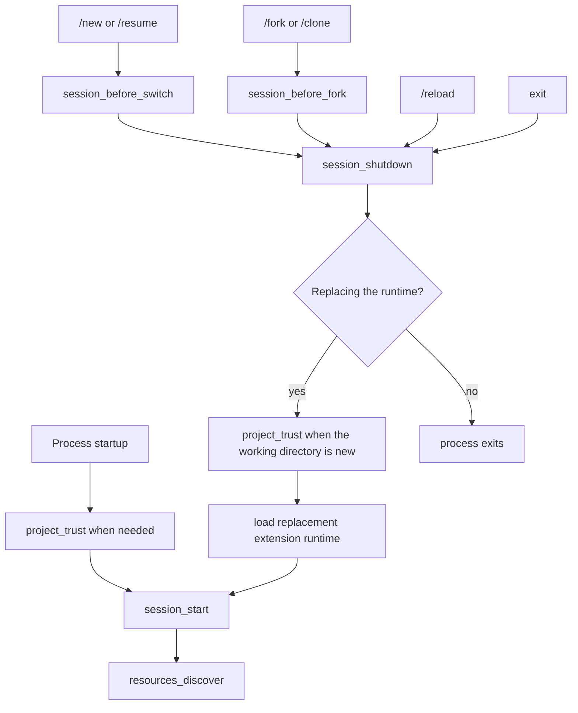

> Pi 可以帮你创建扩展。描述使用场景，让它为你构建一个扩展。

# 扩展

扩展是用于扩展 Pi 行为的 TypeScript 模块。它们可以订阅生命周期事件、注册供 LLM 调用的自定义工具、添加命令等。

扩展运行在 Pi 进程中，并拥有相同的操作系统权限。它可以检查提示词、工具调用、文件、凭据和会话历史，因此只应加载可信来源的扩展。

> **供 /reload 使用的位置：** 将扩展放在 `~/.pi/agent/extensions/`（全局）或 `.pi/extensions/`（项目本地），即可自动发现。`pi -e ./path.ts` 仅用于快速测试。自动发现目录中的扩展可通过 `/reload` 热重载。

**主要能力：**
- **自定义工具**：通过 `pi.registerTool()` 注册供 LLM 调用的工具。
- **事件拦截**：阻止或修改工具调用、注入上下文、自定义压缩。
- **用户交互**：通过 `ctx.ui` 提示用户（选择、确认、输入、通知）。
- **自定义 UI 组件**：通过 `ctx.ui.custom()` 构建支持键盘输入的完整 TUI 组件，以处理复杂交互。
- **自定义命令**：通过 `pi.registerCommand()` 注册 `/mycommand` 等命令。
- **会话持久化**：通过 `pi.appendEntry()` 保存重启后仍保留的状态。
- **自定义渲染**：控制 TUI 中工具调用、结果和消息的显示方式。
- **Provider 和 MCP 服务器**：注册模型 Provider、虚拟模型和 MCP 服务器。

**使用示例：**
- 权限检查（执行 `rm -rf`、`sudo` 等操作前要求确认）。
- Git 检查点（每轮创建 stash，并在切换分支时恢复）。
- 路径保护（禁止写入 `.env`、`node_modules/`）。
- 自定义压缩（按需总结对话）。
- 对话摘要（参见 `summarize.ts` 示例）。
- 交互式工具（提问、向导、自定义对话框）。
- 有状态工具（待办清单、连接池）。
- 外部集成（文件监视器、webhook、CI 触发器）。
- 等待时玩的游戏（参见 `snake.ts` 示例）。

可运行的实现示例请参阅 [examples/extensions/](../examples/extensions/)。

## 目录

- [快速开始](#quick-start)
- [扩展位置](#extension-locations)
- [可用导入](#available-imports)
- [编写扩展](#writing-an-extension)
  - [扩展组织方式](#extension-styles)
- [事件](#events)
  - [生命周期概览](#lifecycle-overview)
  - [处理器组合](#handler-composition)
  - [启动事件](#startup-events)
  - [资源事件](#resource-events)
  - [会话事件](#session-events)
  - [Agent 事件](#agent-events)
  - [模型事件](#model-events)
  - [工具事件](#tool-events)
  - [用户 Bash 事件](#user-bash-events)
  - [输入事件](#input-events)
- [ExtensionContext](#extensioncontext)
- [ExtensionCommandContext](#extensioncommandcontext)
- [ExtensionAPI 方法](#extensionapi-methods)
- [状态管理](#state-management)
- [自定义工具](#custom-tools)
  - [工具暴露方式](#tool-exposure)
  - [调用其他工具](#calling-other-tools)
  - [动态加载工具](#dynamic-tool-loading)
- [MCP 服务器](#mcp-servers)
- [自定义界面](#custom-ui)
- [错误处理](#error-handling)
- [运行模式行为](#mode-behavior)
- [示例索引](#examples-reference)

<a id="create-an-extension"></a>
<a id="quick-start"></a>

## 快速开始

创建 `~/.pi/agent/extensions/my-extension.ts`：

```typescript
import { type ExtensionAPI, isToolCallEventType } from "@earendil-works/pi-coding-agent";
import { Type } from "typebox";

export default function (pi: ExtensionAPI) {
  // React to events
  pi.on("session_start", async (_event, ctx) => {
    ctx.ui.notify("Extension loaded!", "info");
  });

  pi.on("tool_call", async (event, ctx) => {
    if (isToolCallEventType("bash", event) && event.input.command.includes("rm -rf")) {
      const ok = await ctx.ui.confirm("Dangerous!", "Allow rm -rf?");
      if (!ok) return { block: true, reason: "Blocked by user" };
    }
  });

  // Register a custom tool
  pi.registerTool({
    name: "greet",
    label: "Greet",
    description: "Greet someone by name",
    parameters: Type.Object({
      name: Type.String({ description: "Name to greet" }),
    }),
    async execute(toolCallId, params, signal, onUpdate, ctx) {
      return {
        content: [{ type: "text", text: `Hello, ${params.name}!` }],
        details: {},
      };
    },
  });

  // Register a command
  pi.registerCommand("hello", {
    description: "Say hello",
    handler: async (args, ctx) => {
      ctx.ui.notify(`Hello ${args || "world"}!`, "info");
    },
  });
}
```

使用 `--extension`（或 `-e`）参数进行测试：

```bash
pi -e ./my-extension.ts
```

<a id="choose-where-it-loads"></a>
<a id="extension-locations"></a>

## 扩展位置

> **安全提示：** 扩展拥有完整的系统权限，可以执行任意代码。只安装可信来源的扩展。

Pi 会从可信位置自动发现扩展。项目本地 `.pi/extensions` 中的条目只有在项目受信任后才会加载。

| 位置 | 范围 |
|----------|-------|
| `~/.pi/agent/extensions/*.ts` 或 `*.js` | 全局（所有项目） |
| `~/.pi/agent/extensions/*/index.ts` 或 `index.js` | 全局（子目录） |
| 包含 `pi.extensions` 字段的 `~/.pi/agent/extensions/*/package.json` | 全局（含清单的子目录） |
| `.pi/extensions/...` | 项目本地，目录结构相同 |

自动发现最多深入一层目录。较大的软件包应在 `package.json` 清单中声明入口。

Additional paths via `settings.json`:

```json
{
  "packages": [
    "npm:@foo/bar@1.0.0",
    "git:github.com/user/repo@v1"
  ],
  "extensions": [
    "/path/to/local/extension.ts",
    "/path/to/local/extension/dir"
  ]
}
```

设置中也可以使用 `builtin:<name>` 条目指定内置扩展，参见[设置](/settings/#resources)。如需通过 npm 或 git 以 Pi 软件包形式共享扩展，请参阅 [packages.md](/packages/#package-guide)。

<a id="available-imports"></a>

## 可用导入

| 软件包 | 用途 |
|---------|---------|
| `@earendil-works/pi-coding-agent` | 扩展类型（`ExtensionAPI`、`ExtensionContext`、事件）和辅助工具 |
| `@earendil-works/pi-agent-core` | Agent 消息和工具类型 |
| `typebox`、`typebox/compile`、`typebox/value` | 工具参数的 Schema 定义 |
| `@earendil-works/pi-ai` | AI 工具（字符串枚举用的 `StringEnum`、转录辅助工具和模型类型）。在 Pi 内部还会导出 TypeBox 的 `Type`、`Static` 和 `TSchema`，但发布的软件包不再重新导出这些类型；新代码请从 `typebox` 导入 |
| `@earendil-works/pi-ai/compat`、`/models`、`/oauth`、`/providers/all` | Provider 构建、内置 API 和 OAuth 辅助工具 |
| `@earendil-works/pi-tui` | 用于自定义渲染的 TUI 组件 |

Pi 会将这些导入映射到自身使用的副本，使扩展与 Pi 共用相同的类和注册表。旧版 `@mariozechner/*` 和 `@sinclair/typebox` 名称也会映射到相同模块。

也支持 npm 依赖。在扩展旁边（或其父目录）添加 `package.json` 并运行 `npm install`，即可自动解析来自 `node_modules/` 的导入。

通过 `pi install`（npm 或 git）安装并分发的 Pi 软件包，运行时依赖必须放在 `dependencies` 中；`devDependencies` 不会安装。不要将上表中由宿主提供的软件包列入 `dependencies`。参见[声明依赖](/packages/#declare-dependencies)。

<a id="tool-parameter-schemas-and-typebox"></a>

### 工具参数 Schema 与 TypeBox

无论使用何种方式构建 Schema，Pi 都会通过 `@earendil-works/pi-schema` 按 JSON Schema 校验工具参数；TypeBox Schema 本身就是 JSON Schema，无需转换即可使用。校验前会对宽松类型的参数进行强制转换：数字字符串转为数字，`"true"` 转为 `true`，单个值转为仅含一项的数组，可选属性中的 `null` 则会被移除。JSON Schema 之外的 TypeBox 功能不适用于工具参数：

- 不会执行 `Type.Refine()` 精化规则。请在 `execute()` 中检查此类约束。
- 由于 JSON 不支持相应值，`Type.BigInt()`、`Type.Undefined()` 和 `Type.Void()` 会拒绝所有参数。Codec（`Type.Codec()`）不会解码；`execute()` 接收的是 JSON 值。
- 不会检查通过 TypeBox `Format.Set()` 注册的格式；标准格式以及 `url` 和 `json-pointer-uri-fragment` 除外。
- 属性名按名称匹配，而不是按正则表达式匹配；`additionalProperties` 仅应用于对象未声明的属性。
- 指向不存在目标的 `$ref` 只会拒绝其所在位置的参数。

模型看到的校验错误使用 pi-schema 的消息格式，例如 `- path: missing` 或 `- limit: expected number, got string`。

也可以使用 Node.js 内置模块（`node:fs`、`node:path` 等）。

<a id="writing-an-extension"></a>

## 编写扩展

扩展需要导出一个默认工厂函数，并接收 `ExtensionAPI`。工厂可以是同步或异步函数：

```typescript
import type { ExtensionAPI } from "@earendil-works/pi-coding-agent";

export default function (pi: ExtensionAPI) {
  // Subscribe to events
  pi.on("event_name", async (event, ctx) => {
    // ctx.ui for user interaction
    const ok = await ctx.ui.confirm("Title", "Are you sure?");
    ctx.ui.notify("Done!", "info");
    ctx.ui.setStatus("my-ext", "Processing...");  // Footer status
    ctx.ui.setWidget("my-ext", ["Line 1", "Line 2"]);  // Widget above editor (default)
  });

  // Register tools, commands, shortcuts, flags
  pi.registerTool({ ... });
  pi.registerCommand("name", { ... });
  pi.registerShortcut("ctrl+x", { ... });
  pi.registerFlag("my-flag", { ... });
}
```

扩展通过 [jiti](https://github.com/unjs/jiti) 加载，因此 TypeScript 无需预先编译即可使用。

如果工厂返回 `Promise`，Pi 会等待其完成后再继续启动。因此，异步初始化会在 `session_start`、`resources_discover` 触发前完成，也会在通过 `pi.registerProvider()` 排队的 Provider 注册实际执行前完成。

### 异步工厂函数

获取远程配置或动态发现可用模型等一次性启动任务，可使用异步工厂函数。

```typescript
import type { ExtensionAPI } from "@earendil-works/pi-coding-agent";

export default async function (pi: ExtensionAPI) {
  const response = await fetch("http://localhost:1234/v1/models");
  const payload = (await response.json()) as {
    data: Array<{
      id: string;
      name?: string;
      context_window?: number;
      max_tokens?: number;
    }>;
  };

  pi.registerProvider("local-openai", {
    baseUrl: "http://localhost:1234/v1",
    apiKey: "$LOCAL_OPENAI_API_KEY",
    api: "openai-completions",
    models: payload.data.map((model) => ({
      id: model.id,
      name: model.name ?? model.id,
      reasoning: false,
      input: ["text"],
      cost: { input: 0, output: 0, cacheRead: 0, cacheWrite: 0 },
      contextWindow: model.context_window ?? 128000,
      maxTokens: model.max_tokens ?? 4096,
    })),
  });
}
```

此模式会在正常启动和运行 `pi --list-models` 时提供已获取的模型。如果模型列表会在 Pi 运行期间变化，请改为实现 `refreshModels`；参见 [pi.registerProvider()](#piregisterprovidername-config)。

### 长期运行的资源与关闭

扩展工厂可能在不会启动会话的调用中运行。不要在工厂中启动进程、套接字、文件监视器或计时器等后台资源。

请等到 `session_start` 或实际需要该资源的命令、工具或事件触发时，再启动后台资源。应注册幂等的 `session_shutdown` 处理器，以关闭所启动的会话级资源。

<a id="extension-styles"></a>

### 扩展组织方式

**单文件**——最简单，适合小型扩展：

```
~/.pi/agent/extensions/
└── my-extension.ts
```

**包含 index.ts 的目录**——适合由多个文件组成的扩展：

```
~/.pi/agent/extensions/
└── my-extension/
    ├── index.ts        # Entry point (exports default function)
    ├── tools.ts        # Helper module
    └── utils.ts        # Helper module
```

**带依赖的软件包**——适合需要 npm 软件包的扩展：

```
~/.pi/agent/extensions/
└── my-extension/
    ├── package.json    # Declares dependencies and entry points
    ├── package-lock.json
    ├── node_modules/   # After npm install
    └── src/
        └── index.ts
```

```json
// package.json
{
  "name": "my-extension",
  "dependencies": {
    "zod": "^3.0.0",
    "chalk": "^5.0.0"
  },
  "pi": {
    "extensions": ["./src/index.ts"]
  }
}
```

在扩展目录中运行 `npm install`，即可自动解析来自 `node_modules/` 的导入。

<a id="extension-events"></a>
<a id="events"></a>

## 事件

<a id="understand-the-lifecycle"></a>
<a id="lifecycle-overview"></a>

### 生命周期概览

提示词会启动一次运行，首先处理输入：

1. 执行扩展命令（`/name`）对应的处理器，不会触发 `input` 事件。手动输入和 RPC 提示词始终会检查命令；`pi.sendUserMessage()` 只有在 `expandPromptTemplates: true` 时才会检查。
2. `input` 处理器可以拦截、转换或处理文本。
3. 展开 Skill 命令（`/skill:name`）和提示模板（`/template`）。
4. 运行 `before_agent_start`，然后启动 agent 循环。

运行会重复多个轮次，随后检查是否有更多工作需要启动下一次底层 agent 运行：



更多工作包括重试、最终尝试恢复、压缩后重试或处理排队消息。因此，`agent_end` 不表示最终空闲；要判断是否彻底结束，请使用 `agent_settled`。运行中止时会跳过 `agent_before_settle`，从 `agent_end` 直接进入 `agent_settled`。从运行启动开始（包括压缩检查和 `before_agent_start` 阶段），Pi 都视为忙碌状态，因此期间发送的消息会进入正在启动的运行。

每个轮次发送一次模型请求，并执行 assistant 响应中的工具调用：



模型请求会按以下顺序触发钩子：

1. `context`（可修改对话消息）。
2. `context_with_system`（可修改完整转录）。
3. `before_provider_headers`（可修改请求头）。
4. `before_provider_request`（可检查或替换请求载荷）。
5. `after_provider_response`（流被读取前触发，可读取状态和请求头）。
6. `provider_stream_event`（原始解析后流事件），以及 assistant 消息的 `message_start`、`message_update` 和 `message_end`。

实际执行的工具调用会按以下顺序触发钩子：

1. `tool_execution_start`。
2. `tool_call`（可阻止调用或修改输入）。
3. 工具执行期间触发 `tool_execution_update`。
4. `tool_result`（可修改结果）。
5. `tool_execution_end`。

未执行的调用会提前结束。未知工具或无效参数会跳过 `tool_call`；被阻止或中止的调用会跳过执行和 `tool_result`。这些情况仍会通过带错误结果的 `tool_execution_end` 收尾，因此可用它观察所有已结束的调用。

`turn_end` 可以追加条目并请求继续运行。正常需要开始下一轮时，会先检查并执行阈值压缩。用户消息、工具结果和自定义消息等其他消息也会触发消息事件。只有传输方式提供相应阶段时，才会触发 Provider 钩子。

会话启动和替换遵循另一套生命周期：



`session_start` 的 `reason` 为 `"startup" | "reload" | "new" | "resume" | "fork"`；`session_shutdown` 的 `reason` 为 `"quit" | "reload" | "new" | "resume" | "fork"`。重新加载后，`resources_discover` 的 `reason` 为 `"reload"`，否则为 `"startup"`。退出事件涵盖 Ctrl+C、Ctrl+D、SIGHUP 和 SIGTERM。受信任的项目资源加载前会触发 `project_trust`；会话替换进入新的工作目录时也可能再次触发。

其他操作会更改当前会话，但不会替换运行时：

| 操作 | 事件 |
|---|---|
| `/compact` 或自动压缩 | `session_before_compact`（可取消或自定义），随后触发 `session_compact` 或 `session_compact_failed` |
| `/tree` 导航 | `session_before_tree`（可取消或自定义），随后触发 `session_tree` |
| `/name` 或 `pi.setSessionName()` | `session_info_changed` |
| `/model` 或轮换模型（`Ctrl+P`） | 等级发生变化或被限制时触发 `thinking_level_select`，随后触发 `model_select` |
| 更改思考等级（设置、快捷键、`pi.setThinkingLevel()`） | `thinking_level_select` |
| `!` 或 `!!` 命令 | `user_bash`（可拦截） |
| 扩展对话框或自定义界面等待用户操作 | `ui_prompt_start`、`ui_prompt_end` |
| 空闲时刷新提示词缓存 | `cache_warming_decision` |
| 扩展在启动后注册或移除 MCP 服务器 | `mcp_servers_change` |

<a id="events-and-concurrency"></a>
<a id="work-with-events"></a>

<a id="handler-composition"></a>

### 处理器组合

处理器先按扩展加载顺序运行，再按各扩展中的注册顺序运行。有些事件只发送通知；其他事件则会转换数据、替换结果或取消操作：

| 模式 | 行为 |
|---|---|
| 通知 | 返回值会被忽略；此类事件仅用于观察。 |
| 原地修改 | 后续处理器会看到 `before_provider_headers.headers`、`before_agent_start.systemPromptOptions` 和 `tool_call.input` 等值的更改。 |
| 链式转换 | 后续处理器会接收先前 `input`、`context`、`context_with_system`、`message_end`、`tool_result` 和 `before_provider_request` 处理器返回的值。 |
| 拦截 | 已处理的输入、被阻止的工具调用、被取消的会话操作或已处理的 `user_bash` 命令，都会终止该操作的常规后备流程。 |
| 可操作边界 | 每个 `turn_end` 或 `agent_before_settle` 处理器都能看到此前提出的条目和继续运行决策。 |
| 最后覆盖者生效 | 最后一个返回 action 的 `cache_warming_decision` 处理器决定最终结果。 |

通知处理器不应在流式事件中执行耗时操作。转换处理器应保留不归其管理的字段；拦截处理器无法做出安全判断时，应默认拒绝操作。

<a id="startup-events"></a>

### 启动事件

#### project_trust

Pi 决定是否信任包含动态配置（`.pi` 或 `.agents/skills`）的项目之前触发。启动时，以及会话替换（例如 `/resume`）进入当前进程尚未判定信任状态的工作目录时，都会运行此事件。只有用户级/全局扩展和 CLI `-e` 扩展会参与；项目本地扩展要等信任状态确定后才会加载。

```typescript
pi.on("project_trust", async (event, ctx) => {
  // event.cwd - current working directory
  // ctx has a limited trust context: cwd, mode, hasUI, and select/confirm/input/notify UI helpers
  if (await ctx.ui.confirm("Trust project?", event.cwd)) {
    return { trusted: "yes", remember: true };
  }
  return { trusted: "undecided" };
});
```

`project_trust` 处理器必须返回 `{ trusted: "yes" | "no" | "undecided" }`。用户级/全局或 CLI 扩展返回 `"yes"` 或 `"no"` 后即拥有决策权；第一个 yes/no 决定生效，并跳过内置信任提示。设置 `remember: true` 可持久化 yes/no 决定，否则只对当前进程生效。返回 `"undecided"` 可交由后续处理器或内置信任流程决定。提示用户前请检查 `ctx.hasUI`。如果没有处理器返回 yes/no，则继续常规信任判定：先应用已保存的 `trust.json` 决定，再由 `defaultProjectTrust` 控制 Pi 默认询问、信任或拒绝。

<a id="resource-events"></a>

### 资源事件

#### resources_discover

在 `session_start` 后触发，供扩展添加额外的 Skill、提示模板和主题路径。
启动时 `reason` 为 `"startup"`；重新加载时为 `"reload"`。

```typescript
pi.on("resources_discover", async (event, _ctx) => {
  // event.cwd - current working directory
  // event.reason - "startup" | "reload"
  return {
    skillPaths: ["/path/to/skills"],
    promptPaths: ["/path/to/prompts"],
    themePaths: ["/path/to/themes"],
  };
});
```

#### mcp_servers_change

扩展绑定后注册或注销 MCP 服务器时触发。`event.servers` 列出变更后的所有已注册服务器。处理此事件表示该扩展负责连接已注册的服务器；参见 [MCP 服务器](#mcp-servers)。

<a id="session-events"></a>

### 会话事件

会话存储内部机制和 SessionManager API 请参阅[会话格式](/session-format/)。

#### session_start

会话启动、加载或重新加载时触发。

```typescript
pi.on("session_start", async (event, ctx) => {
  // event.reason - "startup" | "reload" | "new" | "resume" | "fork"
  // event.previousSessionFile - present for "new", "resume", and "fork"
  ctx.ui.notify(`Session: ${ctx.sessionManager.getSessionFile() ?? "ephemeral"}`, "info");
});
```

#### session_info_changed

通过 `/name`、RPC 或 `pi.setSessionName()` 设置当前会话显示名称时触发。

```typescript
pi.on("session_info_changed", async (event, ctx) => {
  // event.name - current normalized name, or undefined if cleared
  ctx.ui.notify(`Session renamed: ${event.name ?? "(none)"}`, "info");
});
```

#### session_before_switch

启动新会话（`/new`）或切换会话（`/resume`）之前触发。

```typescript
pi.on("session_before_switch", async (event, ctx) => {
  // event.reason - "new" or "resume"
  // event.targetSessionFile - session we're switching to (only for "resume")

  if (event.reason === "new") {
    const ok = await ctx.ui.confirm("Clear?", "Delete all messages?");
    if (!ok) return { cancel: true };
  }
});
```

成功切换或创建新会话后，Pi 会为旧扩展实例触发 `session_shutdown`，随后为新会话重新加载并绑定扩展，再触发 `session_start`，其 `reason` 为 `"new" | "resume"`，并包含 `previousSessionFile`。
请在 `session_shutdown` 中清理资源，再于 `session_start` 中恢复内存状态。

#### session_before_fork

通过 `/fork` 分叉或通过 `/clone` 克隆会话时触发。

```typescript
pi.on("session_before_fork", async (event, ctx) => {
  // event.entryId - ID of the selected entry
  // event.position - "before" for /fork, "at" for /clone
  return { cancel: true }; // Cancel fork/clone
  // OR
  return { skipConversationRestore: true }; // Reserved for future conversation restore control
});
```

成功分叉或克隆后，Pi 会为旧扩展实例触发 `session_shutdown`，随后为新会话重新加载并绑定扩展，再触发 `session_start`，其 `reason` 为 `"fork"`，并包含 `previousSessionFile`。
请在 `session_shutdown` 中清理资源，再于 `session_start` 中恢复内存状态。

<a id="session_before_compact--session_compact"></a>

#### session_before_compact / session_compact / session_compact_failed

发生上下文压缩时触发。详情请参阅 [compaction.md](/compaction/)。

```typescript
pi.on("session_before_compact", async (event, ctx) => {
  const { preparation, branchEntries, customInstructions, reason, willRetry, signal } = event;

  // reason - "manual" (/compact), "threshold", or "overflow"
  // willRetry - whether the aborted turn is retried after compaction (overflow recovery)

  // Cancel:
  return { cancel: true };

  // Custom summary:
  return {
    compaction: {
      summary: "...",
      firstKeptEntryId: preparation.firstKeptEntryId,
      tokensBefore: preparation.tokensBefore,
      // usage: summaryResponse.usage, // Optional; included in session totals
    }
  };
});

pi.on("session_compact", async (event, ctx) => {
  // event.compactionEntry - the saved compaction
  // event.fromExtension - whether extension provided it
  // event.reason - "manual" (/compact), "threshold", or "overflow"
  // event.willRetry - whether the aborted turn is retried after compaction (overflow recovery)
});

pi.on("session_compact_failed", async (event, ctx) => {
  // event.reason - "manual" (/compact), "threshold", or "overflow"
  // event.errorMessage - present for non-abort failures
  // event.aborted - true for cancelled/aborted compactions
  // event.willRetry - whether the aborted turn would have retried after compaction
  // event.fromExtension - whether extension-provided compaction content was being used
});
```

#### session_before_tree / session_tree

执行 `/tree` 导航时触发。会话树导航概念请参阅[会话](/sessions/)。

```typescript
pi.on("session_before_tree", async (event, ctx) => {
  const { preparation, signal } = event;
  // preparation.targetId, oldLeafId, commonAncestorId, entriesToSummarize,
  // userWantsSummary, customInstructions, replaceInstructions, label
  return { cancel: true };
  // OR provide custom summary (used only when preparation.userWantsSummary is true):
  return {
    summary: {
      summary: "...",
      // usage: summaryResponse.usage, // Optional; included in session totals
      details: {},
    },
  };
  // OR override summarization options: customInstructions, replaceInstructions, label
});

pi.on("session_tree", async (event, ctx) => {
  // event.newLeafId, oldLeafId, summaryEntry, fromExtension
});
```

#### session_shutdown

已启动的会话运行时销毁前触发。可用于清理通过 `session_start` 或其他会话级钩子创建的资源。

```typescript
pi.on("session_shutdown", async (event, ctx) => {
  // event.reason - "quit" | "reload" | "new" | "resume" | "fork"
  // event.targetSessionFile - destination session for session replacement flows
  // Cleanup, save state, etc.
});
```

<a id="agent-events"></a>

### Agent 事件

#### before_agent_start

输入处理和展开完成、运行开始前触发。可注入消息和/或修改 system 提示词。

`event.messageType` 表示运行由何种消息启动：提示词或 `pi.sendUserMessage()` 对应 `"user"`，并包含 `prompt` 和 `images`；空闲时通过 `pi.sendMessage(..., { triggerTurn: true })` 启动则对应 `"custom"`，包含起始 `message`，但不包含 `prompt`。

```typescript
pi.on("before_agent_start", async (event, ctx) => {
  // event.messageType - "user" | "custom"
  // event.prompt, event.images - user's prompt text and images (messageType "user")
  // event.message - the custom message that starts the run (messageType "custom")
  // event.systemPrompt - current chained system prompt for this handler
  //   (includes changes from earlier before_agent_start handlers)
  // event.systemPromptOptions - structured options used to build the system prompt
  //   .customPrompt - exact prompt prefix from --system-prompt, SYSTEM.md, or custom templates
  //   .forceSystemPrompt - optional exact replacement for the complete prompt
  //   .selectedTools - tools currently active in the prompt
  //   .hiddenTools - selected tools whose declarations requests leave out
  //   .toolSnippets - one-line descriptions for each tool
  //   .toolGuidelines - rule bullets keyed by tool name
  //   .promptGuidelines - additional custom rule bullets
  //   .sections - custom XML-wrapped sections keyed by tag name
  //   .appendSystemPrompt - text from --append-system-prompt flags
  //   .cwd - working directory
  //   .contextFiles - AGENTS.md files and other loaded context files
  //   .skills - loaded skills

  return {
    // Inject a persistent message (stored in session, sent to LLM)
    message: {
      customType: "my-extension",
      content: "Additional context for the LLM",
      display: true,
    },
    // Replace the system prompt for this turn (chained across extensions)
    systemPrompt: event.systemPrompt + "\n\nExtra instructions for this turn...",
  };
});
```

返回的 `message` 会添加到这两种运行中；若要跳过由自定义消息启动的运行，请检查 `messageType`。

`systemPromptOptions` 字段使扩展能够访问 Pi 构建 system 提示词时使用的同一份结构化数据。集合可以修改。建议更改 `sections`、`selectedTools` 或 `promptGuidelines`：Pi 会比较生成的提示词分段与模型当前已有内容，并只追加补丁更新已更改的分段。返回 `systemPrompt` 或设置 `forceSystemPrompt` 会替换本次运行的整个提示词：所有 Provider 都会将强制文本作为前置 system 提示词（文本变化时缓存会失效），会话转录仍会记录结构化分段。工具选择变更会同时更新提示词内容和 Provider 可执行工具；在处理器中调用 `pi.setActiveTools()` 与修改 `selectedTools` 效果相同。支持在对话中途接收 system 消息的模型会原位应用补丁并保留缓存前缀；其他模型会将重放后的提示词作为 system 提示词，每次更改都会导致一次缓存未命中。

在 `before_agent_start` 处理器中，`event.systemPrompt` 和 `ctx.getSystemPrompt()` 都反映截至当前处理器的链式 system 提示词。后续的 `before_agent_start` 处理器仍可再次修改它。

<a id="agent_start--agent_end--agent_settled"></a>

#### agent_start / agent_end / agent_before_settle / agent_settled

底层 agent 运行开始时触发 `agent_start`，运行结束时触发 `agent_end`；但之后 Pi 仍可能自动重试、自动压缩后重试，或继续处理排队的后续消息。`agent_before_settle` 是最后一个可操作边界：可追加会话条目并请求继续一次。`agent_settled` 是最终的只读通知；需要确认 Pi 不会自动继续运行的状态集成应使用它。

```typescript
pi.on("agent_start", async (_event, ctx) => {});

pi.on("agent_end", async (event, ctx) => {
  // event.messages - messages from this low-level run
});

let addedReviewReminder = false;
pi.on("agent_before_settle", async (event, ctx) => {
  if (addedReviewReminder) return;
  addedReviewReminder = true;
  return {
    entries: [...event.entries, {
      type: "custom_message",
      customType: "review-reminder",
      content: "Review the final diff before replying.",
      display: false,
    }],
    continue: true,
  };
});

pi.on("agent_settled", async (event, ctx) => {
  // event.aborted - true when the run ended because it was aborted, for example with Escape
  // ctx.isIdle() is true; runs requested here start after all settled handlers finish.
});
```

如果 `agent_before_settle` 处理器运行期间中止了运行，有效返回条目仍会提交，但继续运行的请求会被取消。`agent_settled` 处理器请求的工作会延迟到所有 settled 处理器完成后再执行，因此通知分发不会重入。

#### ui_prompt_start / ui_prompt_end

用于阻塞式用户界面提示的只读生命周期事件。调用 `ctx.ui.select()`、`ctx.ui.confirm()`、`ctx.ui.input()`、`ctx.ui.editor()` 或 `ctx.ui.custom()` 时会触发，使宿主或状态集成可以报告“等待用户操作”，而不只是“正在运行”。

嵌套或重叠的提示会合并为一个外层等待区间。处理器会尽力调用，但显示或关闭提示前不会等待它们完成。

```typescript
pi.on("ui_prompt_start", async (event, ctx) => {
  // event.reason === "ui_prompt"
  // event.kind: "select" | "confirm" | "input" | "editor" | "custom"
  // event.title: prompt title when available
});

pi.on("ui_prompt_end", async (event, ctx) => {
  // Pi is no longer waiting on that UI prompt span.
});
```

#### turn_start / turn_end

每个轮次（一次 LLM 响应及其工具调用）都会触发。

```typescript
pi.on("turn_start", async (event, ctx) => {
  // event.turnIndex, event.timestamp
});

let replacedResponse = false;
pi.on("turn_end", async (event, ctx) => {
  // event.turnIndex, event.message, event.toolResults
  // event.entries contains the structural entries proposed so far.
  if (replacedResponse || event.outcome !== "completed" || event.toolResults.length > 0) return;
  replacedResponse = true;
  return {
    entries: [
      ...event.entries,
      { type: "context_edit", targetId: event.messageEntryId, replacement: null },
      {
        type: "custom_message",
        customType: "replacement-instruction",
        content: "Answer again using the persisted user request.",
        display: false,
      },
    ],
    continue: true,
  };
});
```

assistant 和工具结果消息持久化后、底层 `turn_end` 事件触发前，会运行 `turn_end`。重试等待和最终尝试恢复仍会在 `agent_end` 之后发生，以保持原有生命周期和队列顺序；这些工作完成后，`agent_before_settle` 会看到修复后的投影。边界处理器按扩展加载顺序及注册顺序运行。每个处理器都会在 `event.entries` 中看到先前提案，并看到据此重建的 `event.context`。返回 `entries` 或 `continue` 只会替换对应字段；省略的字段保留当前提案。草稿条目类型仅允许 `custom`、`custom_message`、`context_edit` 和 `compaction`。所有处理器运行完毕后，Pi 会先校验完整提案，再按列表顺序追加；处理器出错会被报告，但后续处理器仍会运行。校验可避免语义错误导致的部分应用，但持久化不是事务性的。

`continue: true` 会确保该边界调用之后再发送一次 Provider 请求。如果工具结果、引导消息或后续消息本来就会触发该请求，则视为已满足此决定，不会额外发送请求；否则 Pi 会发送一次仅包含上下文的请求。错误和中止响应仍会直接结束运行。`continue: false` 不会阻止自然产生的后续工作。请谨慎设置继续条件：无条件返回 `continue: true` 会在下一次响应后再次评估，可能造成无限循环。`custom_message` 草稿会作为 user 角色消息进入模型上下文，但它由扩展生成，不会触发人工输入钩子、斜杠命令、Skills 或提示模板。

构造 `TurnEndEvent` 值的宿主集成必须提供 `messageEntryId`、`toolResultEntryIds`、`outcome`、`entries`、`continue` 和 `context`。`ExtensionEvent` 的穷举分支也必须处理 `agent_before_settle`。`ExtensionRunner.emit()` 不处理可操作的轮次边界；应通过 `emitBoundary(baseEvent, buildContext)` 分发 `turn_end` 和 `agent_before_settle`，使处理器收到串联后的预览。其他专用 runner 方法仍会返回事件结果，例如 `session_before_*`。

#### message_start / message_update / message_end

消息生命周期更新时触发。

- `message_start` 和 `message_end` 会对每条消息触发，包括 user、assistant、工具结果和自定义消息。
- assistant 流式更新时会触发 `message_update`。
- `message_end` 处理器可返回 `{ message }` 替换最终消息；替换消息必须保持相同的 `role`。

```typescript
pi.on("message_start", async (event, ctx) => {
  // event.message
});

pi.on("message_update", async (event, ctx) => {
  // event.message
  // event.assistantMessageEvent (token-by-token stream event)
});

pi.on("message_end", async (event, ctx) => {
  if (event.message.role !== "assistant") return;

  return {
    message: {
      ...event.message,
      usage: {
        ...event.message.usage,
        cost: {
          ...event.message.usage.cost,
          total: 0.123,
        },
      },
    },
  };
});
```

#### tool_execution_start / tool_execution_update / tool_execution_end

工具执行生命周期更新时触发。

并行工具模式下：
- 预检阶段按 assistant 消息中的原始顺序发出 `tool_execution_start`。
- 不同工具的 `tool_execution_update` 事件可能交错出现。
- 每个工具完成后，按工具完成顺序发出 `tool_execution_end`。
- 最终的 `toolResult` 消息事件仍会稍后按 assistant 消息中的原始顺序发出。

```typescript
pi.on("tool_execution_start", async (event, ctx) => {
  // event.toolCallId, event.toolName, event.args
});

pi.on("tool_execution_update", async (event, ctx) => {
  // event.toolCallId, event.toolName, event.args, event.partialResult
});

pi.on("tool_execution_end", async (event, ctx) => {
  // event.toolCallId, event.toolName, event.result, event.isError
  // event.durationMs - milliseconds execute() took; absent when the tool did not run
});
```

如果调用由其他工具发起，这三个事件以及 `tool_call`、`tool_result` 都会携带 `parentToolCallId`；参见[调用其他工具](#calling-other-tools)。

#### context

每次 LLM 调用前触发。请以非破坏性方式修改消息。消息类型请参阅[会话格式](/session-format/)。

```typescript
pi.on("context", async (event, ctx) => {
  // event.messages - deep copy without system messages, safe to modify
  const filtered = event.messages.filter(m => !shouldPrune(m));
  return { messages: filtered };
});
```

`event.messages` 包含对话消息，但不含 system 消息。提示词和工具声明由 Pi 管理，不属于此钩子的输入：处理器返回修改后的列表时，Pi 会重新组合当前提示词分段和工具声明，将其放入一个前置 system 消息，再放在返回的消息之前。因此，即使从压缩摘要处筛选、截取窗口或切片，也不会丢失提示词或工具。若列表未变，则会保留对话中途的 system 消息，使支持此类消息的模型能够继续使用缓存前缀。处理器添加的 system 消息会放在 Pi 的前置消息之后。若要持久更改提示词或工具集，请使用 [`before_agent_start`](#before_agent_start) 或 `pi.setActiveTools()`；若只需为单次请求编辑 system 消息，请使用 [`context_with_system`](#context_with_system)。

#### context_with_system

每次 LLM 调用前触发，在所有 `context` 处理器运行完毕且 Pi 恢复提示词和工具状态后执行。`event.messages` 是完整转录，包含前置 system 消息及对话中途的提示词或工具补丁（参见[会话格式](/session-format/#sessionmessageentry)）。返回的消息会原样发送；此钩子负责该请求的提示词和工具声明。

```typescript
import { getCurrentSystemMessage } from "@earendil-works/pi-ai";

pi.on("context_with_system", async (event, ctx) => {
  const cut = findCutIndex(event.messages);
  // Fold the dropped prefix so its prompt and tool state survives as the new head.
  const head = getCurrentSystemMessage(event.messages.slice(0, cut));
  return { messages: head ? [head, ...event.messages.slice(cut)] : event.messages.slice(cut) };
});
```

规则：索引 0 处必须保留 system 消息（Provider 会从中读取提示词和初始工具声明；处理器将其移除时 Pi 会报错）。移除 system 消息也会移除其中携带的工具声明和分段补丁。请使用 `@earendil-works/pi-ai` 中的 `getCurrentSystemPrompt()` 和 `getCurrentTools()` 检查输出。处理器按扩展加载顺序运行；`before_agent_start` 强制设置的 `systemPrompt` 仍会在之后投射到请求中。

#### before_provider_headers

HTTP 请求头组装完成后触发。可用它添加、覆盖或移除请求头。

处理器会原地修改 `event.headers`。将键设为字符串即可添加或覆盖；设为 `null` 则会删除该请求头。

```typescript
pi.on("before_provider_headers", (event, ctx) => {
  // Add or override — e.g. a session id for gateway tracing/attribution
  event.headers["x-session-id"] = ctx.sessionManager.getSessionId();

  // Drop a tracking header pi adds for this call
  event.headers["X-OpenRouter-Title"] = null;
});
```

每个 Provider 请求触发一次；重试会复用相同请求头，不会再次触发此钩子。

#### before_provider_request

Provider 专属请求载荷构建完成、即将发送请求时触发。处理器按扩展加载顺序运行。返回 `undefined` 表示保持载荷不变；返回其他值则会替换载荷，并传给后续处理器及实际请求。

此钩子可改写或完全移除 Provider 级 system 指令。这些载荷级更改不会反映在 `ctx.getSystemPrompt()` 中；该方法返回 Pi 的 system 提示词字符串，而不是最终序列化后的 Provider 请求载荷。

```typescript
pi.on("before_provider_request", (event, ctx) => {
  console.log(JSON.stringify(event.payload, null, 2));

  // Optional: replace payload
  // return { ...event.payload, temperature: 0 };
});
```

此钩子主要用于调试 Provider 序列化和缓存行为。

载荷包含完整请求。对于会从前一次响应继续的 Provider（如基于 WebSocket 的 OpenAI Codex、Anthropic 消息线程），实际发送内容可能仅包含相较上次请求新增的部分。

#### after_provider_response

收到 HTTP 响应后、读取流式响应体前触发。处理器按扩展加载顺序运行。

```typescript
pi.on("after_provider_response", (event, ctx) => {
  // event.status - HTTP status code
  // event.headers - normalized response headers
  if (event.status === 429) {
    console.log("rate limited", event.headers["retry-after"]);
  }
});
```

请求头是否可用取决于 Provider 和传输方式。对 HTTP 响应进行封装的 Provider 可能不会公开请求头。

#### provider_stream_event

每个 Provider 流事件解析后、Pi 对其规范化之前触发。此事件仅用于通知，不会持久化。

```typescript
pi.on("provider_stream_event", (event, ctx) => {
  // event.provider, event.api, event.model
  // event.data - earliest structured value available to Pi (read-only)
});
```

`event.data` 不一定是原始 HTTP 字节或 SSE 帧。请将其视为只读，因为修改可能影响规范化过程。处理器会按流顺序等待执行，因此运行缓慢会延迟流的读取。处理器错误会被报告，但不会更改 Provider 响应。可选启用的事件查看器示例见 [`debug-provider.ts`](../examples/extensions/debug-provider.ts)，它会按 assistant 消息分组显示原始事件。

#### cache_warming_decision

每次刷新提示词缓存前触发，事件中包含 Pi 已计算的决策。事件只提供 Pi 的成本估算；其他信息请使用 `ctx.model`、`ctx.isIdle()` 和 `ctx.getContextUsage()` 获取。

```typescript
pi.on("cache_warming_decision", (event, ctx) => {
  // event.warmCost: price of this refresh
  // event.missCost: extra price of the next request if the entry is lost
  // event.continuationProbability: pi's estimate that a request arrives in time
  // event.action: "warm" | "stop", pi's decision

  if (ctx.model?.provider === "my-provider") {
    return { action: "stop" };
  }
});
```

返回 `{ action: "warm" }` 或 `{ action: "stop" }` 可覆盖决策；以最后一个返回 action 的处理器为准。`"stop"` 会停止预热，直到下一次实际请求到来。

<a id="model-events"></a>

### 模型事件

#### model_select

通过 `/model` 命令、轮换模型（`Ctrl+P`）或 `pi.setModel()` 更改模型时触发。恢复会话不会触发此事件；请在 `session_start` 中读取 `ctx.model`，初始化依赖模型的状态。

```typescript
pi.on("model_select", async (event, ctx) => {
  // event.model - newly selected model
  // event.previousModel - previous model (undefined if first selection)
  // event.source - "set" | "cycle"

  const prev = event.previousModel
    ? `${event.previousModel.provider}/${event.previousModel.id}`
    : "none";
  const next = `${event.model.provider}/${event.model.id}`;

  ctx.ui.notify(`Model changed (${event.source}): ${prev} -> ${next}`, "info");
});
```

活动模型更改时，可使用此事件更新状态栏、页脚等 UI，或执行特定于模型的初始化。

#### thinking_level_select

思考等级更改时触发。此事件仅用于通知，处理器的返回值会被忽略。

```typescript
pi.on("thinking_level_select", async (event, ctx) => {
  // event.level - newly selected thinking level
  // event.previousLevel - previous thinking level

  ctx.ui.setStatus("thinking", `thinking: ${event.level}`);
});
```

`pi.setThinkingLevel()`、模型更改或内置思考等级控件改变当前等级时，可用此事件更新扩展 UI。

<a id="tool-call-events"></a>
<a id="tool-events"></a>

### 工具事件

#### tool_call

在 `tool_execution_start` 之后、工具执行之前触发。**可以阻止调用。** 使用 `isToolCallEventType` 缩小类型范围并获得类型化输入。

运行 `tool_call` 前，Pi 会等待先前发出的 Agent 事件全部经由 `AgentSession` 处理完毕。因此，`ctx.sessionManager` 中的状态已更新至当前 assistant 工具调用消息。

默认并行执行工具时，同一条 assistant 消息中的同级工具调用会先依次进行预检，再并发执行。`tool_call` 不一定能在 `ctx.sessionManager` 中看到该 assistant 消息中其他工具调用的结果。

`event.input` 可修改。请在工具执行前原地修改，以调整参数。

行为保证：
- 对 `event.input` 的修改会影响实际工具执行。
- 后续 `tool_call` 处理器会看到先前处理器所做的修改。
- 修改后不会重新校验参数。
- `tool_call` 的返回值可通过 `{ block: true, reason?: string, terminate?: boolean }` 控制是否阻止调用。
- `terminate` 仅适用于被阻止的调用；只有批次中所有已完成结果都要求终止时，agent 才会提前停止。

```typescript
import { isToolCallEventType } from "@earendil-works/pi-coding-agent";

pi.on("tool_call", async (event, ctx) => {
  // event.toolName - "bash", "read", "write", "edit", etc.
  // event.toolCallId
  // event.input - tool parameters (mutable)

  // Built-in tools: no type params needed
  if (isToolCallEventType("bash", event)) {
    // event.input is { command: string; timeout?: number }
    event.input.command = `source ~/.profile\n${event.input.command}`;

    if (event.input.command.includes("rm -rf")) {
      return { block: true, reason: "Dangerous command", terminate: true };
    }
  }

  if (isToolCallEventType("read", event)) {
    // event.input is { path: string; offset?: number; limit?: number }
    console.log(`Reading: ${event.input.path}`);
  }
});
```

#### 为自定义工具输入指定类型

自定义工具应导出其输入类型：

```typescript
// my-tool.ts
import { type Static, Type } from "typebox";

export const myToolSchema = Type.Object({ action: Type.String() });
export type MyToolInput = Static<typeof myToolSchema>;
```

使用 `isToolCallEventType` 时显式指定类型参数：

```typescript
import { isToolCallEventType } from "@earendil-works/pi-coding-agent";
import type { MyToolInput } from "./my-tool.ts";

pi.on("tool_call", (event) => {
  if (isToolCallEventType<"my_tool", MyToolInput>("my_tool", event)) {
    event.input.action;  // typed
  }
});
```

#### tool_result

工具执行完成后、发出 `tool_execution_end` 和最终工具结果消息事件之前触发。**可以修改结果。**

并行工具模式下，`tool_result` 和 `tool_execution_end` 可能按工具完成顺序交错触发；最终的 `toolResult` 消息事件仍会稍后按 assistant 消息中的原始顺序发出。

`tool_result` 处理器按中间件方式串联：
- 处理器按扩展加载顺序运行。
- 每个处理器都会看到前序处理器修改后的最新结果。
- 处理器可返回部分补丁（`content`、`details`、`structuredContent`、`isError` 或 `usage`）；省略的字段保持原值。
- 替换 `content` 却不返回 `structuredContent` 时，结构化内容会被丢弃，因为它可能已不再匹配。

处理器内的嵌套异步任务请使用 `ctx.signal`。这样按 Esc 可取消模型调用、`fetch()` 以及扩展启动的其他可中止操作。

```typescript
import { isBashToolResult } from "@earendil-works/pi-coding-agent";

pi.on("tool_result", async (event, ctx) => {
  // event.toolName, event.toolCallId, event.input, event.parentToolCallId
  // event.content, event.details, event.structuredContent, event.isError, event.usage

  if (isBashToolResult(event)) {
    // event.details is typed as BashToolDetails
  }

  const response = await fetch("https://example.com/summarize", {
    method: "POST",
    body: JSON.stringify({ content: event.content }),
    signal: ctx.signal,
  });

  // Modify result:
  return { content: [...], details: {...}, isError: false, usage: nestedModelUsage };
});
```

<a id="user-bash-events"></a>

### 用户 Bash 事件

#### user_bash

用户执行 `!` 或 `!!` 命令时触发。**可以拦截。**

```typescript
import { createLocalBashOperations } from "@earendil-works/pi-coding-agent";

pi.on("user_bash", (event, ctx) => {
  // event.command - the bash command
  // event.excludeFromContext - true if !! prefix
  // event.cwd - working directory

  // Option 1: Provide custom operations (e.g., SSH)
  return { operations: remoteBashOps };

  // Option 2: Wrap pi's built-in local bash backend
  const local = createLocalBashOperations();
  return {
    operations: {
      exec(command, cwd, options) {
        return local.exec(`source ~/.profile\n${command}`, cwd, options);
      }
    }
  };

  // Option 3: Full replacement - return result directly
  return { result: { output: "...", exitCode: 0, cancelled: false, truncated: false } };
});
```

返回 `undefined` 会继续调用下一个处理器；如果没有处理器接管事件，则执行本地命令。有效结果会停止事件传播：`operations` 会通过提供的后端执行命令，而 `result` 仅记录已完成的命令，不会实际执行。

<a id="input-events"></a>

### 输入事件

#### input

收到用户输入后触发，时机在检查扩展命令之后、展开 Skill 和模板之前。事件接收的是原始输入文本，因此 `/skill:foo` 和 `/template` 尚未展开。

**处理顺序：**
1. 首先检查扩展命令（`/cmd`）；若匹配则运行对应处理器，不再触发 input 事件。只有 `expandPromptTemplates: true` 时，才会检查 `pi.sendUserMessage()` 发送的消息。
2. 触发 `input` 事件，可拦截、转换或处理输入。
3. 若未处理，则将 Skill 命令（`/skill:name`）展开为 Skill 内容。
4. 若仍未处理，则将提示模板（`/template`）展开为模板内容。
5. 开始 agent 处理（`before_agent_start` 等）。

```typescript
pi.on("input", async (event, ctx) => {
  // event.text - raw input (before skill/template expansion)
  // event.images - attached images, if any
  // event.source - "interactive" (typed), "rpc" (API), or "extension" (via sendUserMessage)
  // event.streamingBehavior - "steer" | "followUp" | undefined
  //   undefined when idle, "steer" for mid-stream interrupts,
  //   "followUp" for messages queued until the agent finishes

  // Transform: rewrite input before expansion
  if (event.text.startsWith("?quick "))
    return { action: "transform", text: `Respond briefly: ${event.text.slice(7)}` };

  // Handle: respond without LLM (extension shows its own feedback)
  if (event.text === "ping") {
    ctx.ui.notify("pong", "info");
    return { action: "handled" };
  }

  // Route by source: skip processing for extension-injected messages
  if (event.source === "extension") return { action: "continue" };

  // Intercept skill commands before expansion
  if (event.text.startsWith("/skill:")) {
    // Could transform, block, or let pass through
  }

  return { action: "continue" };  // Default: pass through to expansion
});
```

**结果：**
- `continue`：保持原样继续传递（处理器未返回值时的默认行为）。
- `transform`：修改文本或图像，然后继续执行展开。
- `handled`：完全跳过 agent（第一个返回此值的处理器生效）。

多个处理器的转换会依次串联。支持 `streamingBehavior` 路由的示例请参阅 [input-transform.ts](../examples/extensions/input-transform.ts) 和 [input-transform-streaming.ts](../examples/extensions/input-transform-streaming.ts)。

<a id="use-extension-context"></a>

## ExtensionContext

所有处理器都会收到 `ctx: ExtensionContext`。工具的 `execute()` 会收到 `ExtensionToolContext`，其中还包含 `ctx.tools` 和 `ctx.executeTool()`（参见[调用其他工具](#calling-other-tools)）。命令处理器则会收到 [`ExtensionCommandContext`](#extensioncommandcontext)。

### ctx.ui

用于与用户交互的 UI 方法。详情请参阅[自定义界面](#custom-ui)。

### ctx.mode

当前运行模式：`"tui"`、`"rpc"`、`"json"` 或 `"print"`。对于 `custom()`、组件工厂、终端输入和直接 TUI 渲染等仅限终端的功能，请先检查 `ctx.mode === "tui"`。

### ctx.hasUI

在 TUI 和 RPC 模式下为 `true`；在 print 模式（`-p`）和 JSON 模式下为 `false`。可用它检查对话框方法（`select`、`confirm`、`input`、`editor`）以及在 TUI 和 RPC 模式下均可用的即发即弃方法（`notify`、`setStatus`、`setWidget`、`setTitle`、`setEditorText`）。在 RPC 模式下，部分 TUI 专属方法不会执行操作或会返回默认值（参见 [RPC 扩展界面](/rpc-extension-ui/)）。

### ctx.cwd

当前工作目录。

构造项目级配置路径时，请使用 `CONFIG_DIR_NAME`，不要将 `.pi` 硬编码。重新品牌化的发行版可以使用不同的配置目录名称。

```typescript
import { CONFIG_DIR_NAME, type ExtensionAPI } from "@earendil-works/pi-coding-agent";
import { join } from "node:path";

export default function (pi: ExtensionAPI) {
  pi.on("session_start", (_event, ctx) => {
    const projectConfigPath = join(ctx.cwd, CONFIG_DIR_NAME, "my-extension.json");
    // ...
  });
}
```

### ctx.isProjectTrusted()

返回当前会话上下文是否处于项目本地信任状态。结果包括临时信任决定和 CLI 信任覆盖，不仅限于全局信任存储中的已保存决定。

读取仅应在可信项目中生效的项目本地扩展配置前，请先调用此方法。

### ctx.sessionManager

只读访问会话状态：`getCwd()`、`getSessionDir()`、`getSessionId()`、`getSessionFile()`、`getSessionName()`、`getHeader()`、`getEntries()`、`getEntry()`、`getBranch()`、`getTree()`、`getLeafId()`、`getLeafEntry()`、`getLabel()`、`buildContextEntries()` 和 `buildSessionProjection()`。条目类型请参阅[会话格式](/session-format/)。

对于 `tool_call`，处理器运行前状态会同步至当前 assistant 消息。在并行工具执行模式下，仍不能保证状态中包含同一条 assistant 消息里其他工具调用的结果。

```typescript
ctx.sessionManager.getEntries()             // All entries
ctx.sessionManager.getBranch()              // Current branch
ctx.sessionManager.buildContextEntries()    // Active branch entries with compaction applied
ctx.sessionManager.getLeafId()              // Current leaf entry ID
```

### ctx.modelRegistry / ctx.model / ctx.thinkingLevel / ctx.scopedModels

访问模型、Provider 和已解析的认证信息。`ctx.modelRegistry.getProvider(id)` 返回当前生效的 pi-ai Provider；`getProviderAuth(id)` 可解析其当前 API key、请求头、base URL 和 Provider 作用域环境变量，无需先加载模型。`ctx.model` 是活动模型，`ctx.thinkingLevel` 是当前生效的思考等级。

`ctx.scopedModels` 是当前会话可用模型的只读列表，与 `/scoped-models` 命令显示的集合相同。会话启动时，它根据 `--models` CLI 参数和 `enabledModels` 设置解析，并使用 minimatch 将模式与 `provider/modelId` 或单独的 `modelId` 匹配。未配置范围限制时列表为空，表示所有可用模型均可使用。每个条目的结构为 `{ model, thinkingLevel? }`；只有模式固定指定等级时才包含 `thinkingLevel`（例如 `anthropic/*:high`）。构建与内置选择器一致的模型选择器时，可使用此列表，而不必通过 `ctx.modelRegistry.getAvailable()` 枚举整个目录。

#### 流式调用模型

需要使用 `reasoning` 等与 Provider 无关的选项时，请调用 `ctx.modelRegistry.streamSimple(model, context, options)`；需要使用 API 专属选项并等待最终 assistant 消息时，请调用 `complete(model, context, options)`。两者都会使用已配置的 Provider 并解析认证信息，包括通过 `pi.registerProvider()` 注册的 Provider。请优先使用这些方法，而不要使用无法识别扩展 Provider 注册项的 `pi-ai/compat` 流式函数。

`streamSimple()` 返回 `AssistantMessageEventStream`。遍历该对象可读取响应事件，等待 `.result()` 可获取最终消息。初始化失败会产生错误事件和错误结果。

对于非聊天模型，可通过 `findOfType()`、`getModelsOfType()`、`getAvailableOfType()` 和 `getModelOfType()` 查找图像模型和分类器模型，并通过 `classify()` 和 `generateImages()` 调用它们。参见[使用分类器模型](/models/#use-classifier-models)和[使用图像模型](/models/#use-image-models)。

### ctx.signal

当前 agent 的中止 signal；没有活动 agent 轮次时为 `undefined`。

扩展处理器启动的嵌套任务若支持中止，请使用此 signal，例如：
- `fetch(..., { signal: ctx.signal })`
- 接受 `signal` 的模型调用。
- 接受 `AbortSignal` 的文件或进程辅助函数。

在 `tool_call`、`tool_result`、`message_update` 和 `turn_end` 等活动轮次事件期间，`ctx.signal` 通常已定义。
在空闲或非轮次上下文中（例如会话事件、扩展命令，以及 Pi 空闲时触发的快捷键），它通常为 `undefined`。

```typescript
pi.on("tool_result", async (event, ctx) => {
  const response = await fetch("https://example.com/api", {
    method: "POST",
    body: JSON.stringify(event),
    signal: ctx.signal,
  });

  const data = await response.json();
  return { details: data };
});
```

### ctx.isIdle() / ctx.abort() / ctx.hasPendingMessages()

控制流程的辅助方法。Pi 正在处理 agent 运行、自动重试、自动压缩后重试或排队的后续任务时，`ctx.isIdle()` 返回 `false`。

### ctx.shutdown()

请求以有序方式关闭 Pi。

- **交互模式：** 延迟至 agent 空闲后执行（即所有排队的引导消息和后续消息处理完毕后）。
- **RPC 模式：** 会话空闲且没有正在处理的命令时立即执行；否则延迟到当前命令（包括其响应）完成或活动运行结束后执行。（扩展发起的压缩正在运行时发出请求，则会等到下一条命令或运行结束。）
- **Print 模式：** 不执行任何操作。所有提示词处理完毕后进程会自动退出。

退出前会向所有扩展触发 `session_shutdown` 事件。所有上下文均可使用此方法（事件处理器、工具、命令和快捷键）。

```typescript
pi.on("tool_call", (event, ctx) => {
  if (isFatal(event.input)) {
    ctx.shutdown();
  }
});
```

### ctx.getContextUsage()

返回活动模型的当前上下文用量。若有最近一条 assistant 消息的用量则优先使用，否则会估算末尾消息的 token 数。

```typescript
const usage = ctx.getContextUsage();
if (usage?.tokens != null && usage.tokens > 100_000) {
  // ...
}
```

### ctx.compact()

触发压缩但不等待其完成。后续操作请使用 `onComplete` 和 `onError`。

```typescript
ctx.compact({
  customInstructions: "Focus on recent changes",
  onComplete: (result) => {
    ctx.ui.notify("Compaction completed", "info");
  },
  onError: (error) => {
    ctx.ui.notify(`Compaction failed: ${error.message}`, "error");
  },
});
```

### ctx.getSystemPrompt()

返回 Pi 当前的 system 提示词字符串。

- 在 `before_agent_start` 期间，返回值反映截至当前时刻、本轮已串联的 system 提示词更改。
- 不包含之后 `context` 对消息所做的修改。
- 不包含 `before_provider_request` 对请求载荷的改写。
- 若有比你的扩展更晚加载的扩展，它们仍可能更改最终发送的内容。

```typescript
pi.on("before_agent_start", (event, ctx) => {
  const prompt = ctx.getSystemPrompt();
  console.log(`System prompt length: ${prompt.length}`);
});
```

## ExtensionCommandContext

命令处理器会收到 `ExtensionCommandContext`，它在 `ExtensionContext` 的基础上提供会话控制方法。这些方法仅能在命令中使用，因为在事件处理器中调用可能导致死锁。

### ctx.getSystemPromptOptions()

返回 Pi 当前用于构建 system 提示词的基础输入。

```typescript
const options = ctx.getSystemPromptOptions();
const contextPaths = options.contextFiles?.map((file) => file.path) ?? [];
```

其结构和可变性与 `before_agent_start` 的 `event.systemPromptOptions` 相同：自定义或强制提示词、活动工具、工具摘要、工具级和自定义规则、自定义分段、追加的提示词文本、cwd、已加载的上下文文件和 Skills。它可能包含完整的上下文文件内容，因此应视为扩展内部敏感数据，避免通过命令列表、日志或自动补全元数据公开。

此方法报告当前基础提示词输入，不包含每轮 `before_agent_start` 串联的 system 提示词更改、之后 `context` 事件对消息的修改，也不包含 `before_provider_request` 对请求载荷的改写。

### ctx.waitForIdle()

等待 agent 完全结束，包括自动重试、自动压缩后重试和排队的后续任务：

```typescript
pi.registerCommand("my-cmd", {
  handler: async (args, ctx) => {
    await ctx.waitForIdle();
    // Agent is now idle, safe to modify session
  },
});
```

### ctx.newSession(options?)

创建新会话：

```typescript
const parentSession = ctx.sessionManager.getSessionFile();
const kickoff = "Continue in the replacement session";

const result = await ctx.newSession({
  parentSession,
  setup: async (sm) => {
    sm.appendMessage({
      role: "user",
      content: [{ type: "text", text: "Context from previous session..." }],
      timestamp: Date.now(),
    });
  },
  withSession: async (ctx) => {
    // Use only the replacement-session ctx here.
    await ctx.sendUserMessage(kickoff);
  },
});

if (result.cancelled) {
  // An extension cancelled the new session
}
```

选项：
- `parentSession`：记录在新会话头中的父会话文件。
- `setup`：在 `withSession` 运行前修改新会话的 `SessionManager`。
- `withSession`：在新的替换会话上下文中执行切换后的工作。不要使用捕获的旧 `pi` 或命令 `ctx`；参见[会话替换生命周期与注意事项](#session-replacement-lifecycle-and-footguns)。

### ctx.fork(entryId, options?)

从指定条目分叉，并创建新的会话文件：

```typescript
const result = await ctx.fork("entry-id-123", {
  withSession: async (ctx) => {
    // Use only the replacement-session ctx here.
    ctx.ui.notify("Now in the forked session", "info");
  },
});
if (result.cancelled) {
  // An extension cancelled the fork
}

const cloneResult = await ctx.fork("entry-id-456", { position: "at" });
if (cloneResult.cancelled) {
  // An extension cancelled the clone
}
```

选项：
- `position`：`"before"`（默认）在所选用户消息之前分叉，并将该提示词恢复到编辑器中。
- `position`：`"at"` 将活动路径复制到所选条目，但不恢复编辑器文本。
- `withSession`：在新的替换会话上下文中执行切换后的工作。不要使用捕获的旧 `pi` 或命令 `ctx`；参见[会话替换生命周期与注意事项](#session-replacement-lifecycle-and-footguns)。

### ctx.navigateTree(targetId, options?)

导航到会话树中的其他位置。agent 正在响应、手动或自动压缩正在进行，或另一项树导航仍在执行时，此方法会拒绝操作，即使设置了 `summarize: false` 也不例外。发生冲突时活动分支保持不变，Promise 会被拒绝，而不是返回 `{ cancelled: true }`。请等待当前操作完成（例如在命令处理器中使用 `await ctx.waitForIdle()`），然后重试。如果设置了 `summarize` 但没有可用模型，或目标条目不存在，此方法同样会拒绝：

```typescript
const result = await ctx.navigateTree("entry-id-456", {
  summarize: true,
  customInstructions: "Focus on error handling changes",
  replaceInstructions: false, // true = replace default prompt entirely
  label: "review-checkpoint",
});
```

选项：
- `summarize`：是否生成已放弃分支的摘要。
- `customInstructions`：提供给摘要生成器的自定义指示。
- `replaceInstructions`：为 true 时，`customInstructions` 会替换默认提示词，而不是追加到其中。
- `label`：附加到分支摘要条目的标签；若不生成摘要，则附加到目标条目。

### ctx.switchSession(sessionPath, options?)

切换到其他会话文件：

```typescript
const result = await ctx.switchSession("/path/to/session.jsonl", {
  withSession: async (ctx) => {
    await ctx.sendUserMessage("Resume work in the replacement session");
  },
});
if (result.cancelled) {
  // An extension cancelled the switch via session_before_switch
}
```

选项：
- `withSession`：在新的替换会话上下文中执行切换后的工作。不要使用捕获的旧 `pi` 或命令 `ctx`；参见[会话替换生命周期与注意事项](#session-replacement-lifecycle-and-footguns)。

若要发现可用会话，请使用静态方法 `SessionManager.list()` 或 `SessionManager.listAll()`：

```typescript
import { SessionManager } from "@earendil-works/pi-coding-agent";

pi.registerCommand("switch", {
  description: "Switch to another session",
  handler: async (args, ctx) => {
    const sessions = await SessionManager.list(ctx.cwd);
    if (sessions.length === 0) return;
    const choice = await ctx.ui.select(
      "Pick session:",
      sessions.map((s) => s.path),
    );
    if (choice) {
      await ctx.switchSession(choice, {
        withSession: async (ctx) => {
          ctx.ui.notify("Switched session", "info");
        },
      });
    }
  },
});
```

<a id="session-replacement-lifecycle-and-footguns"></a>

### 会话替换生命周期与注意事项

`withSession` 会收到新的 `ReplacedSessionContext`。它扩展了 `ExtensionCommandContext`，并提供绑定到替换会话的异步 `sendMessage()` 和 `sendUserMessage()` 辅助方法。

生命周期和注意事项：
- 只有旧会话触发 `session_shutdown`、旧运行时销毁、替换会话重新绑定且新扩展实例已收到 `session_start` 后，才会运行 `withSession`。
- 回调仍在原始闭包中执行，而不是新扩展实例内部。因此，`withSession` 启动前，旧扩展实例可能已经完成关闭清理。
- 会话替换后，捕获的旧 `pi` 或旧命令 `ctx` 中与会话绑定的对象已经失效，使用时会抛出异常。会话相关操作只能使用传给 `withSession` 的 `ctx`。
- 之前提取的原始对象仍由你负责管理。例如，在替换前捕获 `const sm = ctx.sessionManager`，此时 `sm` 仍是旧的 `SessionManager` 对象；替换后不要继续使用。
- `withSession` 中的代码应假设 `session_shutdown` 处理器使相关状态失效后，这些状态已不存在。只捕获能够安全跨越关闭过程的普通数据，例如字符串、ID 和序列化配置。

安全模式：

```typescript
pi.registerCommand("handoff", {
  handler: async (_args, ctx) => {
    const kickoff = "Continue from the replacement session";
    await ctx.newSession({
      withSession: async (ctx) => {
        await ctx.sendUserMessage(kickoff);
      },
    });
  },
});
```

不安全模式：

```typescript
pi.registerCommand("handoff", {
  handler: async (_args, ctx) => {
    const oldSessionManager = ctx.sessionManager;
    await ctx.newSession({
      withSession: async (_ctx) => {
        // stale old objects: do not do this
        oldSessionManager.getSessionFile();
        pi.sendUserMessage("wrong");
      },
    });
  },
});
```

### ctx.reload()

执行与 `/reload` 相同的重载流程。

```typescript
pi.registerCommand("reload-runtime", {
  description: "Reload extensions, skills, prompts, themes, and context files",
  handler: async (_args, ctx) => {
    await ctx.reload();
    return;
  },
});
```

重要行为：
- `await ctx.reload()` 会为当前扩展运行时触发 `session_shutdown`。
- 随后重新加载资源，并触发 `reason: "reload"` 的 `session_start` 和 `reason: "reload"` 的 `resources_discover`。
- 当前运行的命令处理器仍会在旧调用帧中继续执行。
- `await ctx.reload()` 之后的代码仍来自重载前的版本。
- `await ctx.reload()` 之后，不应假定旧的扩展内存状态仍然有效。
- 处理器返回后，之后的命令、事件和工具调用会使用新版本的扩展。

为确保行为可预测，应将重载视为该处理器的终止操作（`await ctx.reload(); return;`）。

工具收到的是 `ExtensionToolContext`，而非 `ExtensionCommandContext`，因此无法调用 `ctx.reload()`；agent 运行期间 Pi 也无法重载。若要让 LLM 触发重载，可由工具记录请求，再从 `agent_settled` 处理命令；此时处理器发送的消息会在所有 settled 处理器完成后处理：

```typescript
let reloadRequested = false;

pi.registerTool({
  name: "reload_runtime",
  label: "Reload Runtime",
  description: "Reload extensions, skills, prompts, themes, and context files",
  parameters: Type.Object({}),
  async execute() {
    reloadRequested = true;
    return {
      content: [{ type: "text", text: "Reload requested. Pi reloads after this response." }],
      details: {},
      terminate: true,
    };
  },
});

pi.on("agent_settled", () => {
  if (!reloadRequested) return;
  reloadRequested = false;
  pi.sendUserMessage("/reload-runtime", { expandPromptTemplates: true });
});
```

设置 `expandPromptTemplates: true` 会将文本作为命令分发。未设置时，或通过 `deliverAs` 排队时，文本会作为普通用户消息发送给模型。参见 [reload-runtime.ts](../examples/extensions/reload-runtime.ts)。

<a id="extensionapi-methods"></a>

## ExtensionAPI 方法

### pi.on(event, handler)

订阅事件。返回一个取消订阅函数，仅移除此项注册。事件类型和返回值请参阅[事件](#events)。

```typescript
const unsubscribe = pi.on("agent_end", async (event) => {
  unsubscribe();
  await updateIntegration(event.messages);
});
```

处理器先按扩展加载顺序运行，再按各扩展中的注册顺序运行。正在进行事件分发时，添加或移除处理器不会影响当前分发。

### pi.registerTool(definition)

注册供 LLM 调用的自定义工具。详情请参阅[自定义工具](#custom-tools)。

`pi.registerTool()` 可在扩展加载期间和启动后调用，例如在 `session_start`、命令处理器或其他事件处理器中调用。新工具会立即刷新到当前会话，因此无需 `/reload` 就会出现在 `pi.getAllTools()` 中。注册工具时默认会将其启用；设置 `defaultActive: false` 或将[暴露方式](#tool-exposure)设为 `direct` 和 `model-only` 以外的值时除外。

运行期间可使用 `pi.setActiveTools()` 启用或禁用工具（包括动态添加的工具）。

使用 `promptSnippet` 可将自定义工具的一行说明加入默认 system 提示词的 `<tools>` 部分；使用 `promptGuidelines` 可在工具处于活动状态时，将该工具专属的要点追加到 `<rules>` 部分。

**重要：** `promptGuidelines` 要点会直接追加到 `<rules>` 部分，不带工具名前缀。每条指引必须写明所指工具；不要写“Use this tool when...”，因为 LLM 无法判断“this”指什么。请改为“Use my_tool when...”。

完整示例请参阅 [dynamic-tools.ts](../examples/extensions/dynamic-tools.ts)。

```typescript
import { Type } from "typebox";
import { StringEnum } from "@earendil-works/pi-ai";

pi.registerTool({
  name: "my_tool",
  label: "My Tool",
  description: "What this tool does",
  promptSnippet: "Summarize or transform text according to action",
  promptGuidelines: ["Use my_tool when the user asks to summarize previously generated text."],
  parameters: Type.Object({
    action: StringEnum(["list", "add"] as const),
    text: Type.Optional(Type.String()),
  }),

  async execute(toolCallId, params, signal, onUpdate, ctx) {
    // Stream progress; partial results also need details
    onUpdate?.({ content: [{ type: "text", text: "Working..." }], details: { result: "pending" } });

    return {
      content: [{ type: "text", text: "Done" }],
      details: { result: "..." },
    };
  },

  // Optional: Custom rendering
  renderCall(args, theme, context) { ... },
  renderResult(result, options, theme, context) { ... },
});
```

### pi.sendMessage(message, options?)

向会话注入自定义消息。自定义消息会参与 LLM 上下文。若要保存不应发送给 LLM 的持久 TUI 内容，请将 [`pi.appendEntry()`](#piappendentrycustomtype-data) 与 [`pi.registerEntryRenderer()`](#piregisterentryrenderercustomtype-renderer) 配合使用。

```typescript
pi.sendMessage({
  customType: "my-extension",
  content: "Message text",
  display: true,
  details: { ... },
}, {
  triggerTurn: true,
  deliverAs: "steer",
});
```

**选项：**
- `deliverAs`：发送模式：
  - `"steer"`（默认）：流式运行期间将消息排队，在当前 assistant 轮次完成工具调用后、下一次 LLM 调用前发送。
  - `"followUp"`：等待 agent 完成；仅在 agent 不再有工具调用时发送。
  - `"nextTurn"`：排队到下一条用户提示词，不会中断或触发任何操作。
- `triggerTurn: true`：若 agent 空闲，则立即触发 LLM 响应。仅适用于 `"steer"` 和 `"followUp"` 模式（`"nextTurn"` 下忽略）。未设置时，空闲会话只保存消息，不会启动新轮次。
- 流式运行期间设置 `triggerTurn: false`：消息不会作为引导或后续消息排队，而是在当前轮次结束后追加。

### pi.sendUserMessage(content, options?)

向 agent 发送用户消息。与发送自定义消息的 `sendMessage()` 不同，此方法发送真正的用户消息，效果如同用户亲自输入。除非 `input` 处理器已处理消息，或在 `expandPromptTemplates: true` 时运行了扩展命令，否则会启动或排队一个轮次。

```typescript
// Simple text message
pi.sendUserMessage("What is 2+2?");

// With content array (text + images)
pi.sendUserMessage([
  { type: "text", text: "Describe this image:" },
  { type: "image", data: "...", mimeType: "image/png" },
]);

// During streaming - must specify delivery mode
pi.sendUserMessage("Focus on error handling", { deliverAs: "steer" });
pi.sendUserMessage("And then summarize", { deliverAs: "followUp" });

// Opt in to extension command dispatch and skill/prompt template expansion
pi.sendUserMessage("/review src/index.ts", { expandPromptTemplates: true });
```

**选项：**
- `deliverAs`：agent 正在流式运行时必填：
  - `"steer"`：将消息排队，在当前 assistant 轮次完成工具调用后发送。
  - `"followUp"`：等待 agent 完成所有工具调用。
- `expandPromptTemplates`：分发扩展命令，并展开 Skill 命令和提示模板。默认值为 `false`。

未处于流式运行时，消息会立即发送并触发新轮次。流式运行期间若未指定 `deliverAs`，消息会被拒绝，Pi 会报告扩展错误。

完整示例请参阅 [send-user-message.ts](../examples/extensions/send-user-message.ts)。

### pi.appendEntry(customType, data?)

持久化扩展数据。自定义条目**不会**参与 LLM 上下文。在交互模式下，配合 `pi.registerEntryRenderer()` 还可以将其渲染在聊天转录中。

```typescript
pi.appendEntry("my-state", { count: 42 });
pi.appendEntry("status-card", { title: "Indexed files", count: 17 });

// Restore on reload
pi.on("session_start", async (_event, ctx) => {
  for (const entry of ctx.sessionManager.getEntries()) {
    if (entry.type === "custom" && entry.customType === "my-state") {
      // Reconstruct from entry.data
    }
  }
});
```

### pi.setSessionName(name)

设置会话显示名称（在会话选择器中替代首条消息显示）。

```typescript
pi.setSessionName("Refactor auth module");
```

### pi.getSessionName()

获取当前会话名称；未设置时返回空值。

```typescript
const name = pi.getSessionName();
if (name) {
  console.log(`Session: ${name}`);
}
```

### pi.setLabel(entryId, label)

设置或清除条目的标签。标签是用户自定义的书签和导航标记（显示在 `/tree` 选择器中）。

```typescript
// Set a label
pi.setLabel(entryId, "checkpoint-before-refactor");

// Clear a label
pi.setLabel(entryId, undefined);

// Read labels via sessionManager
const label = ctx.sessionManager.getLabel(entryId);
```

标签会保存在会话中，重启后仍然有效。可用它们标记对话树中的重要位置（轮次、检查点）。

### pi.registerCommand(name, options)

注册命令。

多个扩展注册同名命令时，Pi 会全部保留，并按加载顺序分配数字调用后缀，例如 `/review:1` 和 `/review:2`。

```typescript
pi.registerCommand("stats", {
  description: "Show session statistics",
  handler: async (args, ctx) => {
    const count = ctx.sessionManager.getEntries().length;
    ctx.ui.notify(`${count} entries`, "info");
  }
});
```

可选：为 `/command ...` 添加参数自动补全。`getArgumentCompletions` 也可以返回 `Promise`：

```typescript
import type { AutocompleteItem } from "@earendil-works/pi-tui";

pi.registerCommand("deploy", {
  description: "Deploy to an environment",
  getArgumentCompletions: (prefix: string): AutocompleteItem[] | null => {
    const envs = ["dev", "staging", "prod"];
    const items = envs.map((e) => ({ value: e, label: e }));
    const filtered = items.filter((i) => i.value.startsWith(prefix));
    return filtered.length > 0 ? filtered : null;
  },
  handler: async (args, ctx) => {
    ctx.ui.notify(`Deploying: ${args}`, "info");
  },
});
```

### pi.getCommands()

获取当前会话中可通过 `prompt` 调用的斜杠命令，包括扩展命令、提示模板和 Skill 命令。
列表顺序与 RPC `get_commands` 一致：先扩展命令，再提示模板，最后 Skills。Skill 命令的名称格式为 `skill:<name>`。

```typescript
const commands = pi.getCommands();
const bySource = commands.filter((command) => command.source === "extension");
const userScoped = commands.filter((command) => command.sourceInfo.scope === "user");
```

每个条目结构如下：

```typescript
{
  name: string; // Invokable command name without the leading slash. May be suffixed like "review:1"
  description?: string;
  source: "extension" | "prompt" | "skill";
  sourceInfo: {
    path: string;
    source: string;
    scope: "user" | "project" | "temporary";
    origin: "package" | "top-level";
    baseDir?: string;
  };
}
```

应以 `sourceInfo` 作为规范来源字段。不要根据命令名称或临时路径解析来推断归属。

此处不包含 `/model`、`/settings` 等内置交互命令。它们只在交互模式下处理，通过 `prompt` 发送不会执行。

### pi.registerMessageRenderer(customType, renderer)

为指定 `customType` 的自定义消息注册 TUI 渲染器。自定义消息通过 `pi.sendMessage()` 创建，并会参与 LLM 上下文。参见[自定义界面](#custom-ui)。

### pi.registerMarkdownTransformer(transformer, options?)

注册 Markdown 转换器，在 Pi 交互模式渲染前处理 Markdown。转换器按扩展加载顺序运行；每个转换器接收前一个转换器返回的 Markdown。转换链执行完毕后，Pi 使用内置渲染器渲染转换后的内容。

默认情况下，转换器会处理普通用户文本、assistant 文本和思考块。通过 `options.messageTypes` 可指定要处理的内容类型：

| `messageType` | 内容类型 |
|---------------|---------|
| `"user"`、`"assistant"`、`"assistant-thinking"` | 对话转录消息（默认） |
| `"custom"` | 未注册消息渲染器的 `pi.sendMessage()` 自定义消息，以及展开后的 Skill 块（仅内容，不含 Pi 添加的标题） |
| `"summary"` | 展开的分支摘要和压缩摘要（仅摘要内容，不含 Pi 添加的标题） |
| `"changelog"` | Pi 更新日志（启动时的“更新内容”和 `/changelog`）、启动时的“扩展更新”通知，以及“有可用更新”通知中的发行说明 |

转换器会接收 Markdown 字符串和以下上下文：

- `messageType`：上述内容类型之一。
- `isStreaming`：assistant 内容尚未完整时为 `true`，否则为 `false`。
- `availableWidth`：转换后 Markdown 内容可用的准确终端列数。
- `messageId`、`timestamp`：渲染持久化会话条目时对应的会话条目 ID 和 ISO 时间戳；实时消息和通知中为 `undefined`。

返回转换后的 Markdown：

```typescript
pi.registerMarkdownTransformer((markdown, { messageType, isStreaming }) => {
  if (isStreaming || messageType === "assistant-thinking") return markdown;
  return markdown.replaceAll("-->", "→");
});

// Show :warning: shortcodes in changelogs as a symbol.
pi.registerMarkdownTransformer((markdown) => markdown.replaceAll(":warning:", "⚠"), {
  messageTypes: ["changelog"],
});
```

如果转换器抛出异常，Pi 会保留此前已生成的 Markdown，并继续运行下一个转换器。此钩子只影响显示：会话和模型上下文中的原始消息不会更改。新消息、assistant 流式更新、恢复的会话消息以及终端宽度变化都会触发转换，因此转换器应保持同步且轻量。每个扩展只能注册一个转换器；再次注册会替换原有转换器。

### pi.registerEntryRenderer(customType, renderer)

为指定 `customType` 的自定义条目注册 TUI 渲染器。自定义条目通过 `pi.appendEntry()` 创建，不会参与 LLM 上下文。

```typescript
import { Box, Text } from "@earendil-works/pi-tui";

pi.registerEntryRenderer("status-card", (entry, { expanded }, theme) => {
  const data = entry.data as { title: string; count: number };
  const box = new Box(1, 1, (text) => theme.bg("customMessageBg", text));
  box.addChild(new Text(`${theme.bold(data.title)}: ${data.count}`));
  if (expanded) {
    box.addChild(new Text(theme.fg("dim", JSON.stringify(data, null, 2))));
  }
  return box;
});

pi.appendEntry("status-card", { title: "Indexed files", count: 17 });
```

### pi.registerShortcut(shortcut, options)

注册键盘快捷键。快捷键格式和内置快捷键请参阅[快捷键参考](/keybindings/)。

```typescript
pi.registerShortcut("ctrl+shift+p", {
  description: "Toggle plan mode",
  handler: async (ctx) => {
    ctx.ui.notify("Toggled!");
  },
});
```

### pi.registerFlag(name, options)

注册 CLI 标志。

```typescript
pi.registerFlag("plan", {
  description: "Start in plan mode",
  type: "boolean",
  default: false,
});

// Check the value after loading; in the factory, getFlag() returns the default
pi.on("session_start", () => {
  if (pi.getFlag("plan")) {
    // Plan mode enabled
  }
});
```

### pi.exec(command, args, options?)

不经过 Shell 执行命令。

```typescript
const result = await pi.exec("git", ["status"], { signal, timeout: 5000 });
// result.stdout, result.stderr, result.code, result.killed, result.truncated
```

选项：`signal` 和 `timeout` 可终止命令；`cwd` 设置工作目录；`maxBuffer` 限制标准输出和标准错误的总大小（默认 256 MiB）。输出超过 `maxBuffer` 时，Pi 会终止命令，并返回上限内的输出，同时设置 `truncated: true`、`killed: true` 和非零 `code`。Pi 因超时、中止或达到 `maxBuffer` 而终止命令时，`killed` 均为 `true`。忽略 SIGTERM 的命令会在 5 秒后收到 SIGKILL。

### pi.getActiveTools() / pi.getAllTools() / pi.setActiveTools(names)

管理活动工具。此功能适用于内置工具和动态注册的工具。`pi.getActiveTools()` 返回活动工具名称组成的 `string[]`；`pi.getAllTools()` 返回所有已配置工具的元数据。

```typescript
const active = pi.getActiveTools(); // ["read", "bash", ...]
const all = pi.getAllTools();
// all = [{
//   name: "read",
//   description: "Read file contents...",
//   parameters: ...,
//   promptGuidelines: ["Use read to examine files instead of cat or sed."],
//   exposure: "direct",
//   sourceInfo: { path: "builtin:read", source: "builtin", scope: "temporary", origin: "top-level" }
// }, ...]
// Tools shipped with Pi: core tools and tools from built-in extensions such as builtin:mcp
const shippedTools = all.filter((t) => t.sourceInfo.source === "builtin");
// Tools from installed or local extensions
const extensionTools = all.filter((t) => t.sourceInfo.source !== "builtin" && t.sourceInfo.source !== "sdk");
pi.setActiveTools([...new Set([...active, "my_custom_tool"])]); // Keep current tools and enable my_custom_tool
pi.setActiveTools(["read", "bash"]); // Only read and bash
```

`pi.getAllTools()` 会返回 `name`、`description`、`parameters`、`promptGuidelines`、`exposure`、`sourceInfo`，以及（若已设置）`namespace`、`annotations` 和 `reachesTools`。

常见的 `sourceInfo` 取值：
- `source: "builtin"`：Pi 自带的工具，包括核心工具（`path: "builtin:<tool>"`）以及内置扩展注册的工具（如 `builtin:mcp`，`path: "builtin:<extension>"`）。
- `source: "sdk"`：通过 `createAgentSession({ customTools })` 传入的工具。
- 扩展注册的工具则包含扩展来源元数据。

`pi.setActiveTools()` 会忽略未知工具和 `hidden` 工具。无论是否处于活动状态，暴露方式为 `codemode` 或 `deferred` 的工具都可从 codemode 脚本调用。

### pi.setModel(model)

为当前会话设置模型。更改会记录在会话历史中，并在恢复该会话时还原；但不会更改新会话使用的 `defaultProvider` 或 `defaultModel` 配置。如果该模型所属 Provider 尚未配置认证，则返回 `false`。自定义模型配置请参阅[模型指南](/models/#model-guide)。

```typescript
const model = ctx.modelRegistry.find("anthropic", "claude-sonnet-4-5");
if (model) {
  const success = await pi.setModel(model);
  if (!success) {
    ctx.ui.notify("No API key for this model", "error");
  }
}
```

### pi.getThinkingLevel() / pi.setThinkingLevel(level)

获取当前思考等级。等级会限制在模型支持的范围内（不支持推理的模型始终使用 `"off"`）。更改时会触发 `thinking_level_select` 事件。

`pi.setThinkingLevel()` 会更改当前会话的思考等级。更改会记录在会话历史中，并在恢复该会话时还原；但不会影响新会话使用的默认等级。

```typescript
const current = pi.getThinkingLevel();  // "off" | "minimal" | "low" | "medium" | "high" | "xhigh" | "max"
pi.setThinkingLevel("high");
```

### pi.events

供扩展之间通信的共享事件总线：

```typescript
pi.events.on("my:event", (data) => { ... });
pi.events.emit("my:event", { ... });
```

### pi.registerProvider(name, config)

动态注册或覆盖模型 Provider。适用于代理、自定义端点或团队共享的模型配置。

在扩展工厂函数中进行的注册会先排队，待 runner 初始化后统一应用。之后进行的注册（例如用户完成设置流程后在命令处理器中注册）会立即生效，无需运行 `/reload`。

动态 Provider 可以实现 `refreshModels`。Pi 刷新模型时会调用此方法，通过 Provider 同步发布返回的列表，并传入标准化的凭据、已存目录、网络和 signal 上下文。扩展可通过带代次校验的 `context.publish({ persist: entry })` 决定是否持久化目录元数据；llama.cpp 等实时服务器可以只返回模型而不持久化。

`context.signal` 始终是有效的 signal；Provider 回调必须将其传给阻塞式 I/O。公开的 `ModelRuntime.refresh()` 和 `ModelRegistry.refresh()` 可选接收 signal；若省略，则不设超时，由扩展或应用自行决定截止时间。即使 Provider 忽略 signal，取消操作也会停止调用方等待，但要终止底层任务仍需 Provider 配合。

需要原生认证、筛选、刷新或流式处理行为的扩展，可以注册 `@earendil-works/pi-ai` 导出的完整 `Provider`。该 Provider 会作为组合基础，`models.json` 中的覆盖配置仍会应用在其上。

```typescript
import { createProvider, openAICompletionsApi } from "@earendil-works/pi-ai/compat";

const provider = createProvider({
  id: "local-server",
  name: "Local Server",
  baseUrl: "http://localhost:9931/v1",
  auth: {
    apiKey: {
      name: "Local server setup",
      async login(interaction) {
        return {
          type: "api_key",
          key: await interaction.prompt({ type: "secret", message: "API key" }),
        };
      },
      async resolve({ credential }) {
        return credential?.key
          ? { auth: { apiKey: credential.key }, source: "stored API key" }
          : undefined;
      },
    },
  },
  models: [],
  api: openAICompletionsApi(),
});

pi.registerProvider(provider);

// Register a new provider with custom models
pi.registerProvider("my-proxy", {
  name: "My Proxy",
  baseUrl: "https://proxy.example.com",
  apiKey: "$PROXY_API_KEY",  // env var reference
  api: "anthropic-messages",
  models: [
    {
      id: "claude-sonnet-4-20250514",
      name: "Claude 4 Sonnet (proxy)",
      reasoning: false,
      input: ["text", "image"],
      cost: { input: 0, output: 0, cacheRead: 0, cacheWrite: 0 },
      contextWindow: 200000,
      maxTokens: 16384
    }
  ]
});

// Register a live llama.cpp catalog without persisting discovered models
pi.registerProvider("llama.cpp", {
  baseUrl: "http://localhost:9931/v1",
  apiKey: "local",
  api: "openai-completions",
  async refreshModels({ signal }) {
    const response = await fetch("http://localhost:9931/v1/models", { signal });
    const { data } = (await response.json()) as { data: Array<{ id: string }> };
    return data.map(({ id }) => ({
      id,
      name: id,
      reasoning: false,
      input: ["text"],
      cost: { input: 0, output: 0, cacheRead: 0, cacheWrite: 0 },
      contextWindow: 128000,
      maxTokens: 16384
    }));
  }
});

// Override baseUrl for an existing provider (keeps all models)
pi.registerProvider("anthropic", {
  baseUrl: "https://proxy.example.com"
});

// Register provider with OAuth support for /login
pi.registerProvider("corporate-ai", {
  baseUrl: "https://ai.corp.com",
  api: "openai-responses",
  models: [...],
  oauth: {
    name: "Corporate AI (SSO)",
    async login(callbacks) {
      // Custom OAuth flow
      callbacks.onAuth({ url: "https://sso.corp.com/..." });
      const code = await callbacks.onPrompt({ message: "Enter code:" });
      return { refresh: code, access: code, expires: Date.now() + 3600000 };
    },
    async refreshToken(credentials, signal) {
      signal.throwIfAborted();
      // Refresh logic
      return credentials;
    },
    getApiKey(credentials) {
      return credentials.access;
    }
  }
});
```

对象形式接受完整的 pi-ai `Provider`，包括原生的 `auth`、`getModels`、`refreshModels`、`filterModels`、`stream` 和 `streamSimple` 行为。

**旧版配置选项：**
- `name`：Provider 在 `/login` 等界面中显示的名称。
- `baseUrl`：API 端点 URL。每个模型都必须通过模型定义或 Provider 配置该值。
- `apiKey`：API key 字面值、环境变量插值（`$ENV_VAR` 或 `${ENV_VAR}`），或以 `!command` 开头的命令。此项可选；省略时，用户可通过 `/login` 保存密钥。`$$` 用于转义 `$`，`$!` 用于转义字面量 `!`，避免触发命令执行。
- `api`：API 类型，例如 `"anthropic-messages"`、`"openai-completions"`、`"openai-responses"`。
- `headers`：请求中要包含的自定义请求头。
- `authHeader`：设为 true 时，自动添加 `Authorization: Bearer` 请求头。
- `models`：模型定义数组。提供后会替换此 Provider 的所有现有模型。模型定义可以设置 `baseUrl`，覆盖该模型使用的 Provider 端点。
- `refreshModels`：异步动态发现回调。其返回的模型会替换扩展提供的模型。`context.stored` 包含已持久化的 Provider 快照；只有需要持久化更新后的目录数据时，才使用带代次校验的 `context.publish({ persist: entry })`。使用 `persist: null` 可删除该快照。
- `oauth`：供 `/login` 使用的 OAuth Provider 配置。设置后，该 Provider 会出现在登录菜单中。
- `streamSimple`：面向非标准 API 的自定义流式实现。

自定义流式 API、OAuth 详情和模型定义参考等进阶内容请参阅[自定义 Provider](/custom-provider/)。

### pi.unregisterProvider(name)

移除先前注册的 Provider 及其模型。恢复被该 Provider 覆盖的内置模型。如果 Provider 未注册，则不执行任何操作。

与 `registerProvider` 一样，在初始加载阶段之后调用会立即生效，无需运行 `/reload`。

```typescript
pi.registerCommand("my-setup-teardown", {
  description: "Remove the custom proxy provider",
  handler: async (_args, _ctx) => {
    pi.unregisterProvider("my-proxy");
  },
});
```

### pi.registerVirtualModel(model) / pi.unregisterVirtualModel(provider, id)

注册一个可供选择的目录条目，将每个请求路由到物理模型。`ctx.model` 和会话模型选择指向虚拟模型；assistant 消息则记录路由器选定的物理模型和思考等级。再次注册相同 Provider 和 ID 会替换原有虚拟模型。参见[虚拟模型](/virtual-models/)。

### pi.registerMcpServer(name, config) / pi.unregisterMcpServer(name) / pi.getMcpServers()

为当前会话注册 MCP 服务器。参见 [MCP 服务器](#mcp-servers)。

### pi.registerToolRenderer(resolver)

选择任意工具调用的渲染方式，包括尚未注册的工具（例如恢复会话后、MCP 服务器尚未连接时的 MCP 工具）。resolver 会收到工具名称和 `next()`；后者返回剩余 resolver（按扩展加载顺序）及已注册工具将采用的渲染器。因此使用 `next() ?? mine` 只会补充尚未处理的情况。

```typescript
pi.registerToolRenderer((toolName, next) => {
  if (!toolName.startsWith("mcp__")) return next();
  return next() ?? { renderCall: (args, theme) => new Text(theme.fg("toolTitle", toolName), 0, 0) };
});
```

### pi.getSettings()

返回全局与项目设置合并并应用覆盖项后的有效设置副本。

<a id="persist-state"></a>
<a id="state-management"></a>

## 状态管理

有状态的扩展应将状态保存在工具结果的 `details` 中，以正确支持分支：

```typescript
export default function (pi: ExtensionAPI) {
  let items: string[] = [];

  // Reconstruct state from the active branch
  const reconstruct = (ctx: ExtensionContext) => {
    items = [];
    for (const entry of ctx.sessionManager.getBranch()) {
      if (entry.type === "message" && entry.message.role === "toolResult") {
        if (entry.message.toolName === "my_tool") {
          items = (entry.message.details as { items?: string[] } | undefined)?.items ?? [];
        }
      }
    }
  };
  pi.on("session_start", async (_event, ctx) => reconstruct(ctx));
  pi.on("session_tree", async (_event, ctx) => reconstruct(ctx)); // /tree changes the branch

  pi.registerTool({
    name: "my_tool",
    // ...
    async execute(toolCallId, params, signal, onUpdate, ctx) {
      items.push("new item");
      return {
        content: [{ type: "text", text: "Added" }],
        details: { items: [...items] },  // Store for reconstruction
      };
    },
  });
}
```

应从 `getBranch()` 重建状态，而不是遍历所有条目：已放弃的分支代表其他历史。需要持久保存但不应发送给模型的数据，请使用 [`pi.appendEntry()`](#piappendentrycustomtype-data)。

<a id="register-tools"></a>
<a id="custom-tools"></a>

## 自定义工具

通过 `pi.registerTool()` 注册供 LLM 调用的工具。工具会出现在 system 提示词中，也可以自定义渲染方式。

使用 `promptSnippet` 可在默认 system 提示词的 `<tools>` 部分添加一行简短说明。省略该字段时，自定义工具不会列入该部分。

使用 `promptGuidelines` 可在默认 system 提示词的 `<rules>` 部分添加特定于工具的要点。只有工具处于活动状态时才会包含这些要点（例如调用 `pi.setActiveTools([...])` 后）。

**重要：** `promptGuidelines` 要点会直接追加到 `<rules>` 部分，不带工具名前缀，也不分组。每条规则都必须写明所指工具；避免使用“Use this tool when...”，因为 LLM 无法判断“this”指哪个工具。请改写为“Use my_tool when...”。

注意：部分模型会在工具路径参数前添加 `@`。内置工具解析路径前会去除开头的 `@`。如果自定义工具接受路径参数，也应进行相同的规范化。

如果自定义工具会修改文件，请使用 `withFileMutationQueue()`，使其与内置 `edit` 和 `write` 共用按文件划分的队列。这一点很重要，因为工具调用默认并行运行。若不使用队列，两个工具可能读取同一份旧文件内容、分别计算出不同更新，最后写入的结果会覆盖另一个结果。

例如，自定义工具与内置 `edit` 在同一个 assistant 轮次中同时修改 `foo.ts`。如果自定义工具没有加入队列，两者都可能读取原始 `foo.ts` 并分别应用修改，导致其中一项更改丢失。

传给 `withFileMutationQueue()` 的应是真实目标文件路径，而不是原始用户参数。先以 `ctx.cwd` 或工具工作目录为基准，将其解析为绝对路径。对于现有文件，辅助函数会通过 `realpath()` 规范化路径，因此指向同一文件的符号链接别名会共用一个队列。对于新文件，由于尚不能调用 `realpath()`，则使用解析后的绝对路径。

应将针对该目标路径的整个修改过程都放入队列，包括读取、修改和写入，而不仅是最后的写入操作。

```typescript
import { withFileMutationQueue } from "@earendil-works/pi-coding-agent";
import { mkdir, readFile, writeFile } from "node:fs/promises";
import { dirname, resolve } from "node:path";

async execute(_toolCallId, params, _signal, _onUpdate, ctx) {
  const absolutePath = resolve(ctx.cwd, params.path);

  return withFileMutationQueue(absolutePath, async () => {
    await mkdir(dirname(absolutePath), { recursive: true });
    const current = await readFile(absolutePath, "utf8");
    const next = current.replace(params.oldText, params.newText);
    await writeFile(absolutePath, next, "utf8");

    return {
      content: [{ type: "text", text: `Updated ${params.path}` }],
      details: {},
    };
  });
}
```

### 工具定义

```typescript
import { type Static, Type } from "typebox";
import { StringEnum } from "@earendil-works/pi-ai";

const myToolSchema = Type.Object({
  action: StringEnum(["list", "add"] as const),
  text: Type.Optional(Type.String()),
});

pi.registerTool({
  name: "my_tool",
  label: "My Tool",
  description: "What this tool does (shown to LLM)",
  promptSnippet: "List or add items in the project todo list",
  promptGuidelines: [
    "Use my_tool for todo planning instead of direct file edits when the user asks for a task list."
  ],
  parameters: myToolSchema,
  prepareArguments(args) {
    // Fold a legacy `oldAction` field into `action`. Schema validation still runs afterwards.
    const input = (args ?? {}) as { action?: unknown; oldAction?: unknown };
    if (input.action === undefined && input.oldAction !== undefined) {
      return { ...input, action: input.oldAction } as Static<typeof myToolSchema>;
    }
    return args as Static<typeof myToolSchema>;
  },

  async execute(toolCallId, params, signal, onUpdate, ctx) {
    // Check for cancellation
    if (signal?.aborted) {
      return { content: [{ type: "text", text: "Cancelled" }], details: {} };
    }

    // Stream progress updates; partial results also need details
    onUpdate?.({
      content: [{ type: "text", text: "Working..." }],
      details: {},
    });

    // Run commands via pi.exec (captured from extension closure)
    const result = await pi.exec("some-command", [], { signal });

    // Return result
    return {
      content: [{ type: "text", text: "Done" }],  // Sent to LLM
      details: { data: result },                   // For rendering & state
      // usage: nestedModelResponse.usage,          // Optional nested LLM usage
      // Optional: stop after this tool batch when every finalized tool result
      // in the batch also returns terminate: true.
      terminate: true,
    };
  },

  // Optional: Custom rendering
  renderCall(args, theme, context) { ... },
  renderResult(result, options, theme, context) { ... },
});
```

**结果字段：** 每个结果（包括传给 `onUpdate` 的部分结果）都必须包含面向模型的 `content` 和 `details` 值。没有内容需要保存时使用 `details: undefined`；同一工具的所有结果中，`details` 类型必须一致。

**用量统计：** 如果工具内部调用 LLM，应将合并后的 `Usage` 作为 `usage` 返回。Pi 会将其持久化在工具结果中，并计入页脚、`/session` 和 RPC 会话总计。`tool_result` 处理器可以检查或替换此值。

**报告错误：** 若要将工具执行标记为失败，可在 `execute` 中抛出错误，或返回 `isError: true` 的结果。两种方式都会向 LLM 报告错误结果；返回结果的方式还会保留供渲染和脚本使用的 `details` 与 `structuredContent`。其他返回值不会设置错误标志。

**提前终止：** 从 `execute()` 返回 `terminate: true`，提示当前工具批次完成后跳过自动后续 LLM 调用。只有该批次中的每个最终工具结果都设置了终止标志时才会生效。一个以最终结构化输出工具调用结束 agent 的最小示例见 [examples/extensions/structured-output.ts](../examples/extensions/structured-output.ts)。

```typescript
// 正确做法：抛出异常以报告错误
async execute(toolCallId, params) {
  if (!isValid(params.input)) {
    throw new Error(`Invalid input: ${params.input}`);
  }
  return { content: [{ type: "text", text: "OK" }], details: {} };
}
```

**字符串枚举：** 建议使用 `@earendil-works/pi-ai` 中的 `StringEnum`。它会生成所有 Provider 都接受的普通 `enum` Schema。

**结构化输出：** 结果为数据时，请声明 `outputSchema` 并返回匹配的 `structuredContent`。模型仍会收到 `content`；codemode 脚本等程序化调用方会收到 `structuredContent`，而不是文本。未声明 `outputSchema` 的工具会以文本内容形式传给脚本。若要报告错误但仍保留数据，请返回设置了 `isError: true` 的结果，而不要抛出异常：模型会看到错误，脚本仍能收到 `structuredContent`。

**执行模式：** 同一条 assistant 消息中的工具调用默认并行运行。如果工具不能与其他调用并发执行（例如共享可变内存状态），请设置 `executionMode: "sequential"`。

**其他定义字段：**

| 字段 | 用途 |
|---|---|
| `defaultActive` | 设为 `false` 可在注册时保持未启用；可通过 `--tools`、`defaultTools` 设置或 `pi.setActiveTools()` 启用。 |
| `exposure`、`namespace`、`annotations`、`reachesTools`、`prepareLoadout` | 控制模型和其他工具如何访问该工具；参见[工具暴露方式](#tool-exposure)。 |
| `renderShell`、`renderCall`、`renderResult` | 自定义渲染；参见[自定义渲染](#custom-rendering)。 |
| `constrainedSampling` | 可选的 Provider 侧受约束采样请求，用于限制工具参数。 |

先将工具定义赋给变量再注册时，可使用 `defineTool()` 保留参数类型推断。

**参数预处理：** `prepareArguments(args)` 是可选的。若已定义，它会在 Schema 校验和 `execute()` 之前运行。恢复旧会话时，如果存储的工具调用参数已不符合当前 Schema，可用它兼容旧版输入结构。返回的对象会根据 `parameters` 进行校验。请保持公开 Schema 严格；不要仅为了兼容恢复的旧会话，就在 `parameters` 中加入已弃用的兼容字段。

例如，旧会话中的 `edit` 工具调用可能在顶层包含 `oldText` 和 `newText`，而当前 Schema 只接受 `edits: [{ oldText, newText }]`。

```typescript
const editSchema = Type.Object({
  path: Type.String(),
  edits: Type.Array(
    Type.Object({
      oldText: Type.String(),
      newText: Type.String(),
    }),
  ),
});
type EditInput = Static<typeof editSchema>;

pi.registerTool({
  name: "edit",
  label: "Edit",
  description: "Edit a single file using exact text replacement",
  parameters: editSchema,
  prepareArguments(args) {
    const input = (args ?? {}) as Partial<EditInput> & { oldText?: unknown; newText?: unknown };
    if (typeof input.oldText !== "string" || typeof input.newText !== "string") {
      return args as EditInput; // validation reports anything still invalid
    }

    const { oldText, newText, ...rest } = input;
    return { ...rest, edits: [...(input.edits ?? []), { oldText, newText }] } as EditInput;
  },
  async execute(toolCallId, params, signal, onUpdate, ctx) {
    // params now matches the current schema
    return {
      content: [{ type: "text", text: `Applying ${params.edits.length} edit block(s)` }],
      details: {},
    };
  },
});
```

<a id="overriding-built-in-tools"></a>

### 覆盖内置工具

扩展可以注册同名工具以覆盖内置工具（`read`、`bash`、`powershell`、`edit`、`write`、`grep`、`find`、`ls`）。扩展工具会直接替换内置工具，不会发出警告。

```bash
# Extension's read tool replaces built-in read
pi -e ./tool-override.ts
```

也可以使用 `--no-builtin-tools` 启动 Pi，在禁用所有内置工具的同时保留扩展工具：
```bash
# No built-in tools, only extension tools
pi --no-builtin-tools -e ./my-extension.ts
```

通过日志记录和访问控制覆盖 `read` 工具的完整示例请参阅 [examples/extensions/tool-override.ts](../examples/extensions/tool-override.ts)。

**渲染：** 内置渲染器会按槽位分别继承。执行覆盖和渲染覆盖彼此独立。若覆盖工具未提供 `renderCall`，则使用内置的 `renderCall`；未提供 `renderResult` 时则使用内置的 `renderResult`。两者均未提供时，会自动使用完整的内置渲染器（包括语法高亮、差异显示等）。因此可以为内置工具添加日志或访问控制，而不必重新实现 UI。

**提示词元数据：** 内置工具的 `promptSnippet` 和 `promptGuidelines` 不会被继承。若覆盖工具需要保留这些提示词指令，必须在覆盖定义中显式设置。

**实现必须严格匹配结果结构**，包括 `details` 的类型。UI 和会话逻辑依赖这些结构进行渲染和状态跟踪。

Built-in tool implementations:
- [read.ts](https://github.com/earendil-works/pi/blob/main/packages/coding-agent/src/core/tools/read.ts) - `ReadToolDetails`
- [bash.ts](https://github.com/earendil-works/pi/blob/main/packages/coding-agent/src/core/tools/bash.ts) - `BashToolDetails`
- [powershell.ts](https://github.com/earendil-works/pi/blob/main/packages/coding-agent/src/core/tools/powershell.ts) - `PowerShellToolDetails`
- [edit.ts](https://github.com/earendil-works/pi/blob/main/packages/coding-agent/src/core/tools/edit.ts)
- [write.ts](https://github.com/earendil-works/pi/blob/main/packages/coding-agent/src/core/tools/write.ts)
- [grep.ts](https://github.com/earendil-works/pi/blob/main/packages/coding-agent/src/core/tools/grep.ts) - `GrepToolDetails`
- [find.ts](https://github.com/earendil-works/pi/blob/main/packages/coding-agent/src/core/tools/find.ts) - `FindToolDetails`
- [ls.ts](https://github.com/earendil-works/pi/blob/main/packages/coding-agent/src/core/tools/ls.ts) - `LsToolDetails`

<a id="remote-execution"></a>

### 远程执行

内置工具支持可插拔操作，可将任务委托给远程系统（SSH、容器等）：

```typescript
import { createReadTool, type ReadOperations } from "@earendil-works/pi-coding-agent";

const localRead = createReadTool(cwd);

// Register, checking the remote configuration at execution time
pi.registerTool({
  ...localRead,
  async execute(id, params, signal, onUpdate, _ctx) {
    const ssh = getSshConfig();
    if (ssh) {
      const operations: ReadOperations = {
        readFile: (path) => sshReadBuffer(ssh, path), // must resolve to a Buffer
        access: (path) => sshExec(ssh, `test -r ${path}`).then(() => {}),
      };
      return createReadTool(cwd, { operations }).execute(id, params, signal, onUpdate);
    }
    return localRead.execute(id, params, signal, onUpdate);
  },
});
```

`ReadOperations.createReadStream` 为可选项。若它以异步可迭代分块的形式返回文件（Node `Readable` 也适用），`read` 只会将实际显示的行保留在内存中，因此可通过 `offset`/`limit` 读取大文件；若未提供，则 `read` 会通过 `readFile` 加载整个文件。

同样用途的 `create*ToolDefinition()` 工厂（例如 `createReadToolDefinition()`）会返回完整工具定义，包括内置提示词片段和指引。无需复制渲染实现：使用内置名称注册的工具，会对未提供的每个渲染槽位继承内置渲染器（参见[覆盖内置工具](#overriding-built-in-tools)）。

**操作接口：** `ReadOperations`、`WriteOperations`、`EditOperations`、`BashOperations`、`PowerShellOperations`、`LsOperations`、`GrepOperations`、`FindOperations`

`GrepOperations` 只负责目录检查：grep 始终在本地运行 `rg`。如需搜索远程系统，应像 [Gondolin 示例](../examples/extensions/gondolin/index.ts) 一样覆盖 grep 的 `execute()`。

处理 `user_bash` 时，扩展可通过 `createLocalBashOperations()`（或 `createLocalPowerShellOperations()`）复用 Pi 的本地 Shell 后端，无需重新实现本地进程启动、Shell 解析和进程树终止。

`bash` 和 `powershell` 工具还支持 spawn 钩子，可在执行前调整命令、cwd 或 env：

```typescript
import { createBashTool } from "@earendil-works/pi-coding-agent";

const bashTool = createBashTool(cwd, {
  spawnHook: ({ command, cwd, env }) => ({
    command: `source ~/.profile\n${command}`,
    cwd: `/mnt/sandbox${cwd}`,
    env: { ...env, CI: "1" },
  }),
});
```

`createBashTool()` 和 `createPowerShellTool()` 会通过 `PI_SESSION_ID`、`PI_SESSION_FILE`、`PI_PROVIDER`、`PI_MODEL` 和 `PI_REASONING_LEVEL` 将当前会话信息提供给命令。注入发生在 `spawnHook` 之前，因此钩子会在 `env` 中收到这些值；像上例那样展开现有环境时，也会保留这些值。设置 `exposeSessionEnvironment: false` 可禁用此功能：

```typescript
const bashTool = createBashTool(cwd, {
  exposeSessionEnvironment: false,
});
```

变量含义请参阅[Shell 工具会话环境](/environment-variables/#shell-tool-session-environment)。带有 `--ssh` 参数的完整 SSH 示例请参阅 [examples/extensions/ssh.ts](../examples/extensions/ssh.ts)。

<a id="output-truncation"></a>

### 截断输出

**工具必须截断输出**，避免 LLM 上下文过载。过大的输出可能导致：
- 上下文溢出错误（提示词过长）。
- 压缩失败。
- 模型表现下降。

内置限制为 **50KB**（约 10k token）或 **2000 行**，以先达到者为准。请使用导出的截断工具：

```typescript
import {
  truncateHead,      // Keep first N lines/bytes (good for file reads, search results)
  truncateTail,      // Keep last N lines/bytes (good for logs, command output)
  truncateLine,      // Truncate a single line to a character count; returns { text, wasTruncated }
  formatSize,        // Human-readable size (e.g., "50KB", "1.5MB")
  DEFAULT_MAX_BYTES, // 50KB
  DEFAULT_MAX_LINES, // 2000
} from "@earendil-works/pi-coding-agent";

async execute(toolCallId, params, signal, onUpdate, ctx) {
  const output = await runCommand();

  // Apply truncation
  const truncation = truncateHead(output, {
    maxLines: DEFAULT_MAX_LINES,
    maxBytes: DEFAULT_MAX_BYTES,
  });

  let result = truncation.content;

  if (truncation.truncated) {
    // Write full output to temp file
    const tempFile = writeTempFile(output);

    // Inform the LLM where to find complete output
    result += `\n\n[Output truncated: ${truncation.outputLines} of ${truncation.totalLines} lines`;
    result += ` (${formatSize(truncation.outputBytes)} of ${formatSize(truncation.totalBytes)}).`;
    result += ` Full output saved to: ${tempFile}]`;
  }

  return { content: [{ type: "text", text: result }], details: { truncation } };
}
```

**要点：**
- 对开头更重要的内容（搜索结果、文件读取）使用 `truncateHead`。
- 对结尾更重要的内容（日志、命令输出）使用 `truncateTail`。
- 输出被截断时，务必告知 LLM，并说明完整版本的位置。
- 在工具说明中注明截断限制。

使用正确截断方式封装 `rg`（ripgrep）的完整示例请参阅 [examples/extensions/truncated-tool.ts](../examples/extensions/truncated-tool.ts)。

<a id="multiple-tools"></a>

### 多个工具

一个扩展可以注册多个工具并共享状态：

```typescript
export default function (pi: ExtensionAPI) {
  let connection = null;

  pi.registerTool({ name: "db_connect", ... });
  pi.registerTool({ name: "db_query", ... });
  pi.registerTool({ name: "db_close", ... });

  pi.on("session_shutdown", async () => {
    connection?.close();
  });
}
```

<a id="tool-rendering"></a>
<a id="custom-rendering"></a>

### 自定义渲染

工具可以通过 `renderCall` 和 `renderResult` 自定义 TUI 显示。完整组件 API 请参阅 [tui.md](/tui/)，工具行的组合方式请参阅 [tool-execution.ts](https://github.com/earendil-works/pi/blob/main/packages/coding-agent/src/modes/interactive/components/tool-execution.ts)。

默认情况下，工具输出会放在 `Box` 中，由它根据 `outputPad` 设置处理背景和水平内边距。工具渲染器也用于 HTML 导出。已定义的 `renderCall` 或 `renderResult` 必须返回 `Component`。若未定义某个槽位的渲染器，`tool-execution.ts` 会为该槽位使用后备渲染。

工具需要自行渲染外壳、而不使用默认 `Box` 时，请设置 `renderShell: "self"`。适用于需要完全控制边框或背景的工具，例如需要在工具执行结束后仍保持视觉稳定的大型预览。

```typescript
pi.registerTool({
  name: "my_tool",
  label: "My Tool",
  description: "Custom shell example",
  parameters: Type.Object({}),
  renderShell: "self",
  async execute() {
    return { content: [{ type: "text", text: "ok" }], details: undefined };
  },
  renderCall(args, theme, context) {
    return new Text(theme.fg("accent", "my custom shell"), 0, 0);
  },
});
```

`renderCall` 和 `renderResult` 都会收到一个 `context` 对象，包含：
- `args`：当前工具调用参数。
- `state`：在 `renderCall` 和 `renderResult` 间共享的行级状态。
- `lastComponent`：该槽位上次返回的组件（若有）。
- `invalidate()`：请求重新渲染此工具行。
- `toolCallId`、`cwd`、`executionStarted`、`argsComplete`、`isPartial`、`expanded`、`showImages`、`isError`。
- `durationMs`：根据最终结果计算的执行时长；运行中为 `undefined`。
- `outputPad`：来自 `outputPad` 设置的水平内边距；使用 `renderShell: "self"` 的渲染器需自行应用。
- `keyText()`、`keyHint()`：格式化用户配置的快捷键提示，参见[快捷键提示](#keybinding-hints)。

跨槽位共享状态请使用 `context.state`。如果要在多次渲染间复用并更新同一个组件，请将槽位专属缓存保存在返回的组件实例上。

#### renderCall

渲染工具调用或标题：

```typescript
import { Text } from "@earendil-works/pi-tui";

renderCall(args, theme, context) {
  const text = (context.lastComponent as Text | undefined) ?? new Text("", 0, 0);
  let content = theme.fg("toolTitle", theme.bold("my_tool "));
  content += theme.fg("muted", args.action);
  if (args.text) {
    content += " " + theme.fg("dim", `"${args.text}"`);
  }
  text.setText(content);
  return text;
}
```

#### renderResult

渲染工具结果或输出：

```typescript
renderResult(result, { expanded, isPartial }, theme, context) {
  if (isPartial) {
    return new Text(theme.fg("warning", "Processing..."), 0, 0);
  }

  if (result.details?.error) {
    return new Text(theme.fg("error", `Error: ${result.details.error}`), 0, 0);
  }

  let text = theme.fg("success", "✓ Done");
  if (expanded && result.details?.items) {
    for (const item of result.details.items) {
      text += "\n  " + theme.fg("dim", item);
    }
  }
  return new Text(text, 0, 0);
}
```

若某个槽位有意不显示内容，请返回空的 `Component`，例如空 `Container`。

<a id="keybinding-hints"></a>

#### 快捷键提示

使用渲染上下文中的 `keyHint()` 和 `keyText()` 显示遵循用户快捷键配置的提示：

```typescript
renderResult(result, { expanded }, theme, context) {
  let text = theme.fg("success", "✓ Done");
  if (!expanded) {
    text += ` (${context.keyHint("app.tools.expand", "to expand")})`;
  }
  return new Text(text, 0, 0);
}
```

消息和条目渲染器也可通过 `options.keyHint()`/`options.keyText()` 使用相同函数：

- `keyHint(keybinding, description)`：格式化快捷键 ID（例如 `"app.tools.expand"` 或 `"tui.select.confirm"`），并附上说明。
- `keyText(keybinding)`：返回该快捷键 ID 配置的原始按键文本；若未配置按键则返回 `""`。

在渲染器中应使用这些方法，而不要从 `@earendil-works/pi-coding-agent` 导入 `keyHint()` 或 `keyText()`。扩展可能解析到自己的软件包副本（例如其 `node_modules` 中的副本），该副本无法读取 Pi 配置的快捷键，因此 `app.*` ID 会被格式化为空字符串。可安全导入 `rawKeyHint(key, description)` 来格式化字面按键字符串。

快捷键 ID 使用命名空间：
- Coding-agent ID 使用 `app.*` 命名空间，例如 `app.tools.expand`、`app.editor.external`、`app.session.rename`。
- 共用 TUI ID 使用 `tui.*` 命名空间，例如 `tui.select.confirm`、`tui.select.cancel`、`tui.input.tab`。

完整快捷键 ID 和默认值列表请参阅 [keybindings.md](/keybindings/)。`keybindings.json` 使用相同的命名空间 ID。

自定义编辑器和 `ctx.ui.custom()` 组件会通过注入参数收到 `keybindings: KeybindingsManager`。应直接使用该管理器，而不是调用 `getKeybindings()` 或 `setKeybindings()`。

#### 最佳实践

- 使用内边距为 `(0, 0)` 的 `Text`；默认 `Box` 会处理内边距。
- 多行内容使用 `\n`。
- 正确处理流式进度中的 `isPartial`。
- 支持通过 `expanded` 按需显示详情。
- 默认视图保持紧凑。
- 在 `renderResult` 中读取 `context.args`，不要将参数复制到 `context.state`。
- `context.state` 仅用于调用和结果槽位必须共享的数据。
- 可以原地更新同一组件实例时，复用 `context.lastComponent`。
- 只有默认盒状外壳不适用时才使用 `renderShell: "self"`。此模式下，工具需自行负责边框、内边距和背景。

#### 后备渲染

槽位渲染器未定义或抛出异常时：
- `renderCall`：显示工具名称。
- `renderResult`：显示 `content` 中的原始文本。

<a id="dynamic-tool-loading"></a>

### 动态加载工具

扩展可以注册大量工具，但初始时只启用少量工具。工具执行期间可通过 `pi.setActiveTools()` 更改活动工具集。Pi 会在转录的首条 system 消息中保存初始提示词和工具配置，并在下次模型请求前追加工具及提示词增量。无法表示此类增量的 Provider 会收到完整转录检查点，这可能使缓存前缀失效。

流程如下：

1. 使用 `pi.registerTool()` 注册所有工具，使其出现在 `pi.getAllTools()` 中。可搜索的工具设置 `defaultActive: false`，使其初始处于未启用状态。
2. 保持 `search_tools` 等加载器工具处于活动状态。
3. 加载器执行期间，调用 `pi.setActiveTools()` 并传入所需活动工具的名称。名称必须已注册；未知名称和 `hidden` 工具会被忽略。

Pi 还内置了 `tool_search` 工具。将工具的 `exposure` 设为 `"deferred"`，即可由它搜索发现，无需自行编写加载器；参见[工具暴露方式](#tool-exposure)。

#### 搜索工具示例

以下扩展注册了两个默认未启用的可搜索工具，并保持 `search_tools` 活动以便加载它们。示例采用简单关键词匹配；实际搜索也可以使用 BM25、向量嵌入、远程目录或项目专属路由。

```typescript
import type { ExtensionAPI } from "@earendil-works/pi-coding-agent";
import { Type } from "typebox";

const SEARCHABLE_TOOL_NAMES = new Set(["lookup_weather", "search_issues"]);

export default function (pi: ExtensionAPI) {
  pi.registerTool({
    name: "lookup_weather",
    label: "Lookup Weather",
    defaultActive: false,
    description: "Look up the current weather for a city",
    parameters: Type.Object({ city: Type.String() }),
    async execute(_toolCallId, params) {
      return {
        content: [{ type: "text", text: `Weather for ${params.city}: sunny` }],
        details: {},
      };
    },
  });

  pi.registerTool({
    name: "search_issues",
    label: "Search Issues",
    defaultActive: false,
    description: "Search project issues by keyword",
    parameters: Type.Object({ query: Type.String() }),
    async execute(_toolCallId, params) {
      return {
        content: [{ type: "text", text: `No open issues matching ${params.query}` }],
        details: {},
      };
    },
  });

  pi.registerTool({
    name: "search_tools",
    label: "Search Tools",
    description: "Search for and enable tools relevant to a task",
    promptSnippet: "Search for additional tools when the active tools cannot perform the task",
    promptGuidelines: [
      "Use search_tools when a task requires a capability that is not currently available.",
    ],
    parameters: Type.Object({
      query: Type.String({ description: "Capability or task to search for" }),
      limit: Type.Optional(Type.Integer({ minimum: 1, maximum: 10 })),
    }),
    async execute(_toolCallId, params) {
      const terms = params.query.toLowerCase().split(/[^a-z0-9]+/).filter(Boolean);
      const matches = pi.getAllTools()
        .filter((tool) => SEARCHABLE_TOOL_NAMES.has(tool.name))
        .map((tool) => ({
          tool,
          score: terms.reduce(
            (score, term) =>
              score + (`${tool.name} ${tool.description}`.toLowerCase().includes(term) ? 1 : 0),
            0,
          ),
        }))
        .filter((match) => match.score > 0)
        .sort((a, b) => b.score - a.score)
        .slice(0, params.limit ?? 3)
        .map((match) => match.tool.name);

      if (matches.length === 0) {
        return {
          content: [{ type: "text", text: `No tools found for: ${params.query}` }],
          details: { matches: [] as string[], added: [] as string[] },
        };
      }

      const active = pi.getActiveTools();
      const added = matches.filter((name) => !active.includes(name));
      pi.setActiveTools([...new Set([...active, ...added])]);

      return {
        content: [{
          type: "text",
          text: added.length > 0
            ? `Loaded tools: ${added.join(", ")}`
            : `Matching tools already active: ${matches.join(", ")}`,
        }],
        details: { matches, added },
      };
    },
  });
}
```

`search_tools` 添加匹配工具后，模型会在紧接着的下一次请求中收到更新后的完整工具列表。

<a id="tool-exposure"></a>

### 工具暴露方式

`exposure` 控制模型如何访问工具。“可调用”表示其他工具可以通过 `ctx.executeTool()`（`ctx.tools`）调用它，例如 codemode 脚本：

- `direct`（默认）：工具处于活动状态时会声明给模型，也可被调用。
- `model-only`：工具处于活动状态时会声明给模型，但无法被其他工具调用。适用于编排其他工具或向用户提问的工具。
- `codemode`：注册后始终可调用，并列在 `codemode` 工具中；除非显式启用，否则不会声明给模型。
- `deferred`：与 `codemode` 类似，但 codemode 工具不会列出它；`tool_search` 可以发现并启用它。
- `hidden`：已注册但无法访问。由于工具无法注销，可通过重新注册并设置 `exposure: "hidden"` 将其撤下。

`namespace: { name, aliases, description, instructions }` 可将相关工具分组，与 MCP 服务器类似。Codemode 工具会在同一标题下列出命名空间及其 `description`。`instructions` 用于较长的使用说明，不会直接列出；codemode 脚本可通过 `describeNamespace(name)` 读取。`aliases` 是脚本查找命名空间时可使用的其他名称，例如 `mcp__docs` 服务器可使用 `docs` 作为别名；名称和对应的脚本标识符（如 `my-docs`、`my_docs`）均可匹配。

注册 `direct` 或 `model-only` 工具时，默认会将其启用；设置 `defaultActive: false` 可关闭此行为。其他暴露方式的工具注册后不会自动启用。活动工具集（由 `pi.getActiveTools()`、`pi.setActiveTools()` 管理）就是声明给模型的工具集合，但 `prepareLoadout` 隐藏声明的活动工具除外。`pi.getAllTools()` 会报告每个工具的 `exposure`、`namespace`、`annotations` 和 `reachesTools`。

`annotations` 是描述工具行为的提示，语义与 MCP 工具注解相同：`readOnlyHint`、`destructiveHint`、`idempotentHint` 和 `openWorldHint`。MCP 工具会携带服务器声明的提示。缺省时采用 MCP 默认值：工具不视为只读，并可能具有破坏性或访问开放环境。这些提示未经验证，但权限扩展可据此决定哪些调用需要确认。以下示例会确认 Codex 要求批准的调用：

```typescript
pi.on("tool_call", async (event, ctx) => {
  const hints = pi.getAllTools().find((tool) => tool.name === event.toolName)?.annotations;
  const needsApproval =
    hints?.destructiveHint === true ||
    (!hints?.readOnlyHint && ((hints?.destructiveHint ?? true) || (hints?.openWorldHint ?? true)));
  if (needsApproval && !(await ctx.ui.confirm("Allow tool call?", event.toolName))) {
    return { block: true, reason: `${event.toolName} was not approved` };
  }
});
```

编排其他工具的工具可通过 `prepareLoadout(loadout)` 调整其活动期间模型可见的内容。每当活动工具变化时都会运行此方法，并接收已声明工具、可调用工具，以及每个已注册工具的暴露方式、命名空间和提示词指引。它会返回已声明工具（包括自身）的替代 `descriptions`，以及 `hiddenDeclarations`：声明需要隐藏、但仍保持活动且可调用的工具。默认 system 提示词会将隐藏工具从工具列表和规则中省略；隐藏文件读取工具时，Skills 提示也不会提及任何工具，因此编排工具应自行提供相关指引。`codemode` 仅使用此钩子、`exposure`、`reachesTools` 和 `ctx.executeTool()` 实现该行为，其他工具也可使用不同名称实现相同机制。

会调用其他工具的工具可通过 `reachesTools(input)` 声明一次调用可能访问哪些工具：返回 `"all"`，或返回可能包含工具名称的输入文本词语；每个词会匹配名称中包含它的所有工具或命名空间。需要搜索或列出工具的脚本会使 `codemode` 返回 `"all"`，其他脚本则返回脚本中的词语；`tool_search` 始终返回 `"all"`。延迟注册工具的扩展可在 `tool_call` 处理器中使用此机制，在调用执行前完成所需工具的注册；MCP 扩展会对仍在连接的服务器执行此操作。MCP 扩展也只有在同名工具声明了 `reachesTools` 时，才会为 MCP 工具启用 `codemode` 或 `tool_search`。

<a id="calling-other-tools"></a>

### 调用其他工具

工具可通过 `ctx.executeTool(name, args, { signal, onUpdate })` 调用其他工具。`ctx.tools` 列出它可以调用的工具。工具故障不会导致此调用 reject：未知工具、校验错误、被阻止的调用和抛出的异常都会作为 `isError: true` 的结果返回。

嵌套调用与模型发起的调用一样，会进行参数校验、经过 `tool_call` 和 `tool_result` 处理器，并触发 `tool_execution_start`、`tool_execution_update` 和 `tool_execution_end`。这些事件都带有 `parentToolCallId`；其 `toolCallId` 由 Pi 按 `<parent id>/<n>` 格式分配。这些 ID 不会作为工具调用或工具结果出现在转录中。

嵌套调用不会新增转录条目：其结果只会返回给发起调用的工具，由该工具自行报告，例如通过 `onUpdate` 和 `details`。会话会在调用工具的结果消息中，以 `nestedCalls` 保存有上限的调用记录（名称、参数、状态、时长和错误，不含结果）。该记录用于压缩时生成文件列表，并显示在 HTML 导出中。单次调用参数超过 8 KiB 或单个工具结果超过 32 KiB 时会省略相关内容；最多保存 256 次调用。若记录有内容丢失，则会标记 `complete: false`。

各层嵌套结果的 `usage` 都会累加到发起调用工具结果的 `usage` 中，因此工具只需报告自身用量，无需重复报告其调用工具的用量。

<a id="mcp-servers"></a>

## MCP 服务器

`pi.registerMcpServer(name, config)` 会为当前会话添加 MCP 服务器。`config` 结构与 [`mcp.json`](/mcp/) 中的 `mcpServers` 条目相同：stdio 服务器使用 `command`、`args`、`env` 和 `cwd`；HTTP 服务器使用 `url`、`headers` 和 `oauth`；两种类型都支持 `exposure`、`toolExposure`、`description`、`enabled` 和 `timeout`。

```typescript
pi.registerMcpServer("jira", { url: "https://mcp.example.com/jira", exposure: "codemode" });
pi.unregisterMcpServer("jira");
```

扩展加载期间注册的服务器会在会话启动时与 `mcp.json` 中的服务器一同连接；之后注册的服务器会立即连接。`pi.unregisterMcpServer()` 会关闭连接并使服务器工具不可访问。注册信息不会保存，因此每次加载时都要重新注册，例如根据扩展自身设置注册。同名的 `mcp.json` 服务器优先级更高，`/mcp` 会显示覆盖关系。再次注册相同名称会替换该扩展之前的注册项；名称已由其他扩展注册、名称无效或配置无效时会抛出异常。

内置 MCP 支持会连接已注册的服务器。如果它被其他扩展替换（参见 [MCP](/mcp/#replace-the-built-in-mcp-support)），且没有其他扩展负责连接，则每条注册记录都会报告为扩展错误。其他 MCP 扩展也可以连接已注册的服务器：在 `session_start` 中使用 `pi.getMcpServers()` 读取服务器，并通过 `mcp_servers_change` 事件处理后续变化。

<a id="interact-with-the-user"></a>
<a id="custom-ui"></a>

## 自定义界面

扩展可以通过 `ctx.ui` 方法与用户交互，并自定义消息和工具的渲染方式。

自定义组件、焦点、覆盖层、主题和渲染性能请参阅[终端界面](/tui/)。其中的示例涵盖选择列表、设置开关、可取消加载器、页脚和 widget。

### 对话框

```typescript
// Select from options
const choice = await ctx.ui.select("Pick one:", ["A", "B", "C"]);

// Confirm dialog
const ok = await ctx.ui.confirm("Delete?", "This cannot be undone");

// Text input
const name = await ctx.ui.input("Name:", "placeholder");

// Multi-line editor
const text = await ctx.ui.editor("Edit:", "prefilled text");

// Notification (non-blocking)
ctx.ui.notify("Done!", "info");  // "info" | "warning" | "error"
```

#### 带倒计时的定时对话框

对话框支持 `timeout` 选项，可显示实时倒计时并在超时后自动关闭：

```typescript
// Dialog shows "Title (5s)" → "Title (4s)" → ... → auto-dismisses at 0
const confirmed = await ctx.ui.confirm(
  "Timed Confirmation",
  "This dialog will auto-cancel in 5 seconds. Confirm?",
  { timeout: 5000 }
);

if (confirmed) {
  // User confirmed
} else {
  // User cancelled or timed out
}
```

**Return values on timeout:**
- `select()` returns `undefined`
- `confirm()` returns `false`
- `input()` returns `undefined`

#### 使用 AbortSignal 手动关闭

如需更精细的控制（例如区分超时与用户取消），请使用 `AbortSignal`：

```typescript
const controller = new AbortController();
const timeoutId = setTimeout(() => controller.abort(), 5000);

const confirmed = await ctx.ui.confirm(
  "Timed Confirmation",
  "This dialog will auto-cancel in 5 seconds. Confirm?",
  { signal: controller.signal }
);

clearTimeout(timeoutId);

if (confirmed) {
  // User confirmed
} else if (controller.signal.aborted) {
  // Dialog timed out
} else {
  // User cancelled (pressed Escape or selected "No")
}
```

完整示例请参阅 [examples/extensions/timed-confirm.ts](../examples/extensions/timed-confirm.ts)。

### Widget、状态和页脚

```typescript
// Status in footer (persistent until cleared)
ctx.ui.setStatus("my-ext", "Processing...");
ctx.ui.setStatus("my-ext", undefined);  // Clear

// Working loader (shown during streaming)
ctx.ui.setWorkingMessage("Thinking deeply...");
ctx.ui.setWorkingMessage();  // Restore default
ctx.ui.setWorkingVisible(false);  // Hide the built-in working loader row entirely
ctx.ui.setWorkingVisible(true);   // Show the built-in working loader row

// Working indicator (shown during streaming)
ctx.ui.setWorkingIndicator({ frames: [ctx.ui.theme.fg("accent", "●")] });  // Static dot
ctx.ui.setWorkingIndicator({
  frames: [
    ctx.ui.theme.fg("dim", "·"),
    ctx.ui.theme.fg("muted", "•"),
    ctx.ui.theme.fg("accent", "●"),
    ctx.ui.theme.fg("muted", "•"),
  ],
  intervalMs: 120,
});
ctx.ui.setWorkingIndicator({ frames: [] });  // Hide indicator
ctx.ui.setWorkingIndicator();  // Restore default spinner

// Widget above editor (default)
ctx.ui.setWidget("my-widget", ["Line 1", "Line 2"]);
// Widget below editor
ctx.ui.setWidget("my-widget", ["Line 1", "Line 2"], { placement: "belowEditor" });
ctx.ui.setWidget("my-widget", (tui, theme) => new Text(theme.fg("accent", "Custom"), 0, 0));
ctx.ui.setWidget("my-widget", undefined);  // Clear

// Custom footer (replaces built-in footer entirely)
// footerData provides the git branch and extension statuses from setStatus()
ctx.ui.setFooter((tui, theme, footerData) => ({
  render(width) { return [theme.fg("dim", "Custom footer")]; },
  invalidate() {},
}));
ctx.ui.setFooter(undefined);  // Restore built-in footer

// Custom header shown at startup above the chat
ctx.ui.setHeader((tui, theme) => new Text(theme.fg("accent", "my-project"), 0, 0));
ctx.ui.setHeader(undefined);  // Restore built-in header

// Label shown for hidden thinking blocks
ctx.ui.setHiddenThinkingLabel("Reasoning...");
ctx.ui.setHiddenThinkingLabel();  // Restore default

// Raw terminal input (interactive mode only); return { consume: true } to swallow it
const unsubscribe = ctx.ui.onTerminalInput((data) => undefined);

// Terminal title
ctx.ui.setTitle("pi - my-project");

// Editor text
ctx.ui.setEditorText("Prefill text");
const current = ctx.ui.getEditorText();

// Paste into editor (triggers paste handling, including collapse for large content)
ctx.ui.pasteToEditor("pasted content");

// Stack custom autocomplete behavior on top of the built-in provider
ctx.ui.addAutocompleteProvider((current) => ({
  triggerCharacters: ["#"],
  async getSuggestions(lines, line, col, options) {
    const beforeCursor = (lines[line] ?? "").slice(0, col);
    const match = beforeCursor.match(/(?:^|[ \t])#([^\s#]*)$/);
    if (!match) {
      return current.getSuggestions(lines, line, col, options);
    }

    return {
      prefix: `#${match[1] ?? ""}`,
      items: [{ value: "#2983", label: "#2983", description: "Extension API for autocomplete" }],
    };
  },
  applyCompletion(lines, line, col, item, prefix) {
    return current.applyCompletion(lines, line, col, item, prefix);
  },
  shouldTriggerFileCompletion(lines, line, col) {
    return current.shouldTriggerFileCompletion?.(lines, line, col) ?? true;
  },
}));

// Tool output expansion
const wasExpanded = ctx.ui.getToolsExpanded();
ctx.ui.setToolsExpanded(true);
ctx.ui.setToolsExpanded(wasExpanded);

// Custom editor (vim mode, emacs mode, etc.)
ctx.ui.setEditorComponent((tui, theme, keybindings) => new VimEditor(tui, theme, keybindings));
const currentEditor = ctx.ui.getEditorComponent();
ctx.ui.setEditorComponent((tui, theme, keybindings) =>
  new WrappedEditor(tui, theme, keybindings, currentEditor?.(tui, theme, keybindings))
);
ctx.ui.setEditorComponent(undefined);  // Restore default editor

// Theme management (see themes.md for creating themes)
const themes = ctx.ui.getAllThemes();  // [{ name: "dark", path: "/..." | undefined }, ...]
const lightTheme = ctx.ui.getTheme("light");  // Load without switching
const result = ctx.ui.setTheme("light");  // Switch by name
if (!result.success) {
  ctx.ui.notify(`Failed: ${result.error}`, "error");
}
ctx.ui.setTheme(lightTheme!);  // Or switch by Theme object
ctx.ui.theme.fg("accent", "styled text");  // Access current theme
```

自定义工作指示器帧会按原样渲染。如需颜色，请自行在帧字符串中添加，例如使用 `ctx.ui.theme.fg(...)`。

### 自动补全提供方

使用 `ctx.ui.addAutocompleteProvider()` 可在内置斜杠命令和路径提供方之上叠加自定义自动补全逻辑。通过 `triggerCharacters` 可设置 `$` 等自定义触发字符。

典型流程：

- 检查光标前的文本。
- 匹配扩展专属语法时返回自定义建议。
- 否则委托给 `current.getSuggestions(...)`。
- 除非需要自定义插入行为，否则将处理委托给 `applyCompletion(...)`。

```typescript
pi.on("session_start", (_event, ctx) => {
  ctx.ui.addAutocompleteProvider((current) => ({
    triggerCharacters: ["#"],
    async getSuggestions(lines, cursorLine, cursorCol, options) {
      const line = lines[cursorLine] ?? "";
      const beforeCursor = line.slice(0, cursorCol);
      const match = beforeCursor.match(/(?:^|[ \t])#([^\s#]*)$/);
      if (!match) {
        return current.getSuggestions(lines, cursorLine, cursorCol, options);
      }

      return {
        prefix: `#${match[1] ?? ""}`,
        items: [
          { value: "#2983", label: "#2983", description: "Extension API for registering custom @ autocomplete providers" },
          { value: "#2753", label: "#2753", description: "Reload stale resource settings" },
        ],
      };
    },

    applyCompletion(lines, cursorLine, cursorCol, item, prefix) {
      return current.applyCompletion(lines, cursorLine, cursorCol, item, prefix);
    },

    shouldTriggerFileCompletion(lines, cursorLine, cursorCol) {
      return current.shouldTriggerFileCompletion?.(lines, cursorLine, cursorCol) ?? true;
    },
  }));
});
```

完整示例请参阅 [github-issue-autocomplete.ts](../examples/extensions/github-issue-autocomplete.ts)：它使用 `gh issue list` 预加载最新的未关闭 GitHub issue，并在本地筛选以快速补全 `#...`。此示例需要 GitHub CLI（`gh`）及一个 GitHub 仓库的本地检出。

### 自定义组件

对于复杂界面，请使用 `ctx.ui.custom()`。它会暂时用自定义组件替换编辑器，直到调用 `done()`：

```typescript
import { truncateToWidth } from "@earendil-works/pi-tui";

const result = await ctx.ui.custom<boolean>((tui, theme, keybindings, done) => ({
  render(width: number): string[] {
    return [truncateToWidth(theme.fg("accent", "Press Enter to confirm, Escape to cancel"), width)];
  },
  handleInput(data: string): void {
    if (keybindings.matches(data, "tui.select.confirm")) done(true);
    else if (keybindings.matches(data, "tui.select.cancel")) done(false);
  },
  invalidate() {},
}));

if (result) {
  // User pressed Enter
}
```

回调会收到以下参数：
- `tui`：TUI 实例（用于获取屏幕尺寸和管理焦点）。
- `theme`：用于设置样式的当前主题。
- `keybindings`：应用快捷键管理器（用于检查快捷键）。
- `done(value)`：关闭组件并返回结果。

工厂也可以返回一个解析为组件的 `Promise`。带缓存渲染的完整自定义界面请参阅[终端界面](/tui/#build-a-minimal-custom-screen)。

#### 覆盖层模式（实验性）

传入 `{ overlay: true }` 可将组件作为浮动模态层绘制在现有内容上方，而不清屏：

```typescript
const result = await ctx.ui.custom<string | null>(
  (tui, theme, keybindings, done) => new MyOverlayComponent({ onClose: done }),
  { overlay: true }
);
```

如需高级定位（锚点、边距、百分比和响应式显隐），请传入 `overlayOptions`。可通过 `onHandle` 以编程方式控制焦点或可见性：

```typescript
const result = await ctx.ui.custom<string | null>(
  (tui, theme, keybindings, done) => new MyOverlayComponent({ onClose: done }),
  {
    overlay: true,
    overlayOptions: { anchor: "top-right", width: "50%", margin: 2 },
    onHandle: (handle) => {
      handle.focus(); // focus this overlay and bring it to the visual front
      // handle.unfocus({ target: editorComponent }); // release input to a specific component
      // handle.setHidden(true/false); // toggle visibility
      // handle.isHidden(), handle.isFocused(), handle.getBounds()
    }
  }
);
```

`overlayOptions` 也可以是函数，以便重新计算动态位置。请使用 `done()` 结束交互；不要对 `ctx.ui.custom()` 创建的覆盖层调用 `handle.hide()`。

获得焦点且可见的覆盖层可在临时的非覆盖层自定义界面关闭后重新接管输入。如果希望覆盖层保持可见、同时让其他组件继续接收输入，请调用 `handle.unfocus({ target })`。传入 `{ target: null }` 会释放覆盖层焦点，但不会将焦点转移给其他组件。

完整 API 请参阅 [`OverlayOptions` 和 `OverlayHandle`](https://github.com/earendil-works/pi/blob/main/packages/tui/src/tui.ts)，示例请参阅 [overlay-qa-tests.ts](../examples/extensions/overlay-qa-tests.ts)。

### 自定义编辑器

使用自定义实现（例如 vim 或 emacs 模式）替换主输入编辑器：

```typescript
import { CustomEditor, type ExtensionAPI } from "@earendil-works/pi-coding-agent";
import { matchesKey } from "@earendil-works/pi-tui";

class VimEditor extends CustomEditor {
  private mode: "normal" | "insert" = "insert";

  handleInput(data: string): void {
    if (matchesKey(data, "escape") && this.mode === "insert") {
      this.mode = "normal";
      return;
    }
    if (this.mode === "normal" && data === "i") {
      this.mode = "insert";
      return;
    }
    super.handleInput(data);  // App keybindings + text editing
  }
}

export default function (pi: ExtensionAPI) {
  pi.on("session_start", (_event, ctx) => {
    ctx.ui.setEditorComponent((tui, theme, keybindings) =>
      new VimEditor(tui, theme, keybindings)
    );
  });
}
```

**Key points:**
- 请继承 `CustomEditor`（而不是基类 `Editor`），以获得应用快捷键（Esc 中止、Ctrl+D、切换模型）。
- 对未处理的按键调用 `super.handleInput(data)`。
- 自定义编辑器默认保留独立的工作状态行。若要改用内置的编辑器边框旋转指示器，请将 `{ embedWorkingStatus: true }` 作为 `CustomEditor` 构造函数的第四个参数传入。
- 工厂会从应用接收 `tui`、`theme` 和 `keybindings`。
- 调用 `setEditorComponent()` 前先使用 `ctx.ui.getEditorComponent()`，即可包装此前配置的自定义编辑器。
- 传入 `undefined` 可恢复默认编辑器：`ctx.ui.setEditorComponent(undefined)`

若要与已替换编辑器的其他扩展组合，请在设置自己的工厂前保存之前的工厂：

```typescript
const previous = ctx.ui.getEditorComponent();
ctx.ui.setEditorComponent((tui, theme, keybindings) =>
  new MyEditor(tui, theme, keybindings, { base: previous?.(tui, theme, keybindings) })
);
```

带模式指示器的完整示例请参阅 [modal-editor.ts](../examples/extensions/modal-editor.ts)。

### 消息和条目渲染

为指定 `customType` 的消息注册自定义渲染器。需要参与 LLM 上下文的内容应使用消息渲染器：

```typescript
import { Text } from "@earendil-works/pi-tui";

pi.registerMessageRenderer("my-extension", (message, options, theme) => {
  const { expanded, outputPad } = options;
  let text = theme.fg("accent", `[${message.customType}] `);
  text += message.content;

  if (expanded && message.details) {
    text += "\n" + theme.fg("dim", JSON.stringify(message.details, null, 2));
  } else if (message.details) {
    text += ` (${options.keyHint("app.tools.expand", "to expand")})`;
  }

  return new Text(text, outputPad, 0);
});
```

通过 `pi.sendMessage()` 发送消息：

```typescript
pi.sendMessage({
  customType: "my-extension",  // Matches registerMessageRenderer
  content: "Status update",
  display: true,               // Show in TUI
  details: { ... },            // Available in renderer
});
```

对于仅供 TUI 显示、不应发送给 LLM 的内容，请改用自定义条目渲染：

```typescript
pi.registerEntryRenderer("my-card", (entry, options, theme) => {
  return new Text(theme.fg("accent", JSON.stringify(entry.data)));
});

pi.appendEntry("my-card", { status: "done" });
```

### 主题颜色

所有渲染函数都会收到 `theme` 对象。创建自定义主题和查看完整调色板请参阅[主题](/themes/)。

```typescript
// Foreground colors
theme.fg("toolTitle", text)   // Tool names
theme.fg("accent", text)      // Highlights
theme.fg("success", text)     // Success (green)
theme.fg("error", text)       // Errors (red)
theme.fg("warning", text)     // Warnings (yellow)
theme.fg("muted", text)       // Secondary text
theme.fg("dim", text)         // Tertiary text

// Text styles
theme.bold(text)
theme.italic(text)
theme.underline(text)
theme.strikethrough(text)

// Combined foreground, background, and attributes
theme.style(text, { fg: "success", bg: "toolSuccessBg", bold: true })
```

`theme.colors` 提供具体颜色，`theme.appearance` 的值为 `"dark"` 或 `"light"`。参见[正确应用主题](/tui/#apply-themes-correctly)。

在自定义工具渲染器中进行语法高亮：

```typescript
import { highlightCode, getLanguageFromPath } from "@earendil-works/pi-coding-agent";

// Highlight code with an explicit language; returns one string per line
const lines = highlightCode("const x = 1;", "typescript");

// Auto-detect language from file path
const lang = getLanguageFromPath("/path/to/file.rs");  // "rust", or undefined
const highlighted = highlightCode(code, lang);
```

<a id="handle-errors-and-shutdown"></a>

<a id="error-handling"></a>

## 错误处理

- 扩展错误会记录日志，agent 会继续运行。
- `tool_call` 错误会阻止工具执行（故障安全）。
- `user_bash` 错误会阻止命令执行，而不会回退到本地执行。
- 工具 `execute` 的错误可通过抛出异常或返回 `isError: true` 表示；抛出的异常会被捕获并作为错误结果报告给 LLM，之后继续执行。

<a id="ui-and-modes"></a>
<a id="account-for-each-mode"></a>

<a id="mode-behavior"></a>

## 运行模式行为

| 模式 | `ctx.mode` | `ctx.hasUI` | 说明 |
|------|------------|-------------|-------|
| 交互模式 | `"tui"` | `true` | 完整 TUI 和终端渲染。 |
| RPC（`--mode rpc`） | `"rpc"` | `true` | 通过 JSON 协议提供对话框和通知；`custom()` 返回 `undefined`，组件工厂会被忽略。参见 [RPC 扩展界面](/rpc-extension-ui/)。 |
| JSON（`--mode json`） | `"json"` | `false` | 事件流输出到 stdout；UI 方法不执行任何操作。 |
| Print（`-p`） | `"print"` | `false` | 扩展会运行，但不能提示用户。 |

使用 `custom()`、组件工厂、终端输入等 TUI 专属功能前，请检查 `ctx.mode === "tui"`。调用 TUI 和 RPC 模式均支持的对话框及通知方法前，请检查 `ctx.hasUI`。

<a id="use-examples-as-the-implementation-reference"></a>

<a id="examples-reference"></a>

## 示例索引

所有示例均位于 [examples/extensions/](../examples/extensions/) 目录。

| 示例 | 说明 | 主要 API |
|---------|-------------|----------|
| **工具** |||
| `hello.ts` | 最简工具注册 | `registerTool` |
| `question.ts` | 带用户交互的工具 | `registerTool`、`ui.custom`、`renderResult` |
| `questionnaire.ts` | 多步骤向导工具 | `registerTool`、`ui.custom` |
| `todo.ts` | 在 `details` 中保存可感知分支的状态工具 | `registerTool`、`renderResult`、`registerCommand`、`on("session_start")`、`on("session_tree")` |
| `dynamic-tools.ts` | 在启动后和命令运行期间注册工具 | `registerTool`、`session_start`、`registerCommand` |
| `structured-output.ts` | 使用 `terminate: true` 的最终结构化输出工具 | `registerTool`、终止型工具结果 |
| `truncated-tool.ts` | 输出截断示例 | `registerTool`、`truncateHead` |
| `tic-tac-toe.ts` | 必须按顺序运行的工具 | `registerTool`、`executionMode: "sequential"`、`ui.custom` |
| `tool-override.ts` | 覆盖内置 read 工具 | `registerTool`（与内置工具同名） |
| `built-in-tool-renderer.ts` | 自定义内置工具渲染 | `create*ToolDefinition`、`renderCall`、`renderResult`、`renderShell` |
| `minimal-mode.ts` | 折叠显示内置工具 | 覆盖内置工具、`renderResult` |
| **命令** |||
| `pirate.ts` | 按轮次修改 system 提示词 | `registerCommand`、`before_agent_start` |
| `summarize.ts` | 对话摘要命令 | `registerCommand`、`ui.custom` |
| `handoff.ts` | 跨 Provider 模型交接 | `registerCommand`、`ui.editor`、`ui.custom` |
| `qna.ts` | 使用自定义界面进行问答 | `registerCommand`、`ui.custom`、`setEditorText` |
| `send-user-message.ts` | 注入用户消息 | `registerCommand`、`sendUserMessage` |
| `reload-runtime.ts` | 重载命令和 LLM 工具交接 | `registerCommand`、`ctx.reload()`、`on("agent_settled")`、`sendUserMessage` |
| `shutdown-command.ts` | 有序关闭命令 | `registerCommand`、`shutdown()` |
| **事件与拦截** |||
| `permission-gate.ts` | 阻止危险命令 | `on("tool_call")`、`ui.select` |
| `project-trust.ts` | 由用户级/全局或 CLI 扩展决定或延后项目授权 | `on("project_trust")`、信任 UI、必需的信任结果 |
| `protected-paths.ts` | 阻止写入指定路径 | `on("tool_call")` |
| `confirm-destructive.ts` | 确认会话更改 | `on("session_before_switch")`、`on("session_before_fork")` |
| `dirty-repo-guard.ts` | Git 仓库有未提交更改时发出警告 | `on("session_before_*")`、`exec` |
| `input-transform.ts` | 转换用户输入 | `on("input")` |
| `input-transform-streaming.ts` | 感知流式状态的输入转换 | `on("input")`、`streamingBehavior` |
| `model-status.ts` | 响应模型变更 | `on("model_select")`、`setStatus` |
| `provider-payload.ts` | 检查请求载荷和 Provider 响应头 | `on("before_provider_request")`、`on("after_provider_response")` |
| `debug-provider.ts` | 查看原始 Provider 流事件 | `on("provider_stream_event")`、`appendEntry`、`registerEntryRenderer` |
| `system-prompt-header.ts` | 显示 system 提示词信息 | `on("agent_start")`、`getSystemPrompt` |
| `claude-rules.ts` | 从文件加载规则 | `on("session_start")`、`on("before_agent_start")` |
| `prompt-customizer.ts` | 使用 `systemPromptOptions` 添加感知上下文的工具指引 | `on("before_agent_start")`、`BuildSystemPromptOptions` |
| `file-trigger.ts` | 文件监视器触发消息 | `sendMessage` |
| **压缩与会话** |||
| `custom-compaction.ts` | 自定义压缩摘要 | `on("session_before_compact")` |
| `trigger-compact.ts` | 手动触发压缩 | `compact()` |
| `git-checkpoint.ts` | 按轮次创建 Git stash | `on("turn_start")`、`on("tool_result")`、`on("agent_settled")`、`on("session_before_fork")`、`exec` |
| `git-merge-and-resolve.ts` | 获取更新、合并并解决冲突 | `on("agent_end")`、`exec`、`sendUserMessage` |
| `auto-commit-on-exit.ts` | 关闭时提交更改 | `on("session_shutdown")`、`exec` |
| **UI 组件** |||
| `status-line.ts` | 页脚状态指示器 | `setStatus`、会话事件 |
| `working-indicator.ts` | 自定义流式运行指示器 | `setWorkingIndicator`、`registerCommand` |
| `github-issue-autocomplete.ts` | 通过 `gh issue list` 预载近期未关闭 issue，在内置自动补全中添加 `#1234` 格式的建议 | `addAutocompleteProvider`、`on("session_start")`、`exec` |
| `custom-footer.ts` | 完全替换页脚 | `registerCommand`、`setFooter` |
| `custom-header.ts` | 替换启动页眉 | `on("session_start")`、`setHeader` |
| `modal-editor.ts` | Vim 风格模态编辑器 | `setEditorComponent`、`CustomEditor` |
| `rainbow-editor.ts` | 自定义编辑器样式 | `setEditorComponent` |
| `widget-placement.ts` | 在编辑器上方/下方放置 widget | `setWidget` |
| `overlay-test.ts` | 覆盖层组件 | 带覆盖层选项的 `ui.custom` |
| `overlay-qa-tests.ts` | 全面的覆盖层测试 | `ui.custom`、所有覆盖层选项 |
| `notify.ts` | Agent 完成时发送原生终端通知 | `on("agent_settled")` |
| `titlebar-spinner.ts` | 工作期间在终端标题中显示旋转指示器 | `setTitle` |
| `hidden-thinking-label.ts` | 隐藏思考块的标签 | `setHiddenThinkingLabel` |
| `border-status-editor.ts` | 在编辑器边框中显示状态 | `setEditorComponent`、`CustomEditor` |
| `rpc-demo.ts` | 所有 RPC 支持的 UI 方法 | RPC 模式下的 `ui.*` |
| `timed-confirm.ts` | 带超时的对话框 | 带 timeout/signal 的 `ui.confirm` |
| `mac-system-theme.ts` | 自动切换主题 | `setTheme`、`exec` |
| **复杂扩展** |||
| `plan-mode/` | 完整的计划模式实现 | 所有事件类型、`registerCommand`、`registerShortcut`、`registerFlag`、`setStatus`、`setWidget`、`sendMessage`、`setActiveTools` |
| `preset.ts` | 可保存的预设（模型、工具、思考等级） | `registerCommand`、`registerShortcut`、`registerFlag`、`setModel`、`setActiveTools`、`setThinkingLevel`、`appendEntry` |
| `tools.ts` | 切换工具启用状态的界面 | `registerCommand`、`setActiveTools`、`SettingsList`、会话事件 |
| **远程执行与沙箱** |||
| `ssh.ts` | SSH 远程执行 | `registerFlag`、`on("user_bash")`、`on("before_agent_start")`、工具操作 |
| `interactive-shell.ts` | 持久化 Shell 会话 | `on("user_bash")` |
| `gondolin/` | 将内置工具和 `!` 命令路由到 Gondolin 微型虚拟机 | 工具操作、覆盖内置工具、`on("user_bash")` |
| `subagent/` | 启动子 agent | `registerTool`、`exec` |
| **游戏** |||
| `snake.ts` | 贪吃蛇游戏 | `registerCommand`、`ui.custom`、键盘处理 |
| `space-invaders.ts` | 太空侵略者游戏 | `registerCommand`、`ui.custom` |
| `doom-overlay/` | 在覆盖层中运行 Doom | 带覆盖层的 `ui.custom` |
| **服务提供方** |||
| `custom-provider-anthropic/` | 自定义 Anthropic 代理 | `registerProvider` |
| `custom-provider-gitlab-duo/` | GitLab Duo 集成 | 带 OAuth 的 `registerProvider` |
| `jev-router.ts` | 将规划和实现路由到不同模型的虚拟模型 | `registerVirtualModel` |
| **消息与通信** |||
| `message-renderer.ts` | 自定义消息渲染 | `registerMessageRenderer`、`sendMessage` |
| `entry-renderer.ts` | 仅供 TUI 使用的自定义条目渲染 | `registerEntryRenderer`、`appendEntry` |
| `event-bus.ts` | 扩展间事件 | `pi.events` |
| **会话元数据** |||
| `session-name.ts` | 为会话选择器中的会话命名 | `setSessionName`、`getSessionName` |
| `bookmark.ts` | 为 `/tree` 中的条目添加书签 | `setLabel` |
| **其他** |||
| `commands.ts` | 列出可用斜杠命令 | `getCommands` |
| `dynamic-resources/` | 运行时添加 Skills、提示模板和主题 | `on("resources_discover")` |
| `inline-bash.ts` | 展开用户提示词中的内联 `!{command}` | `on("input")`、`exec` |
| `bash-spawn-hook.ts` | 执行前调整 bash 命令、cwd 和 env | `createBashTool`、`spawnHook` |
| `with-deps/` | 带 npm 依赖的扩展 | 含 `package.json` 的软件包结构 |
